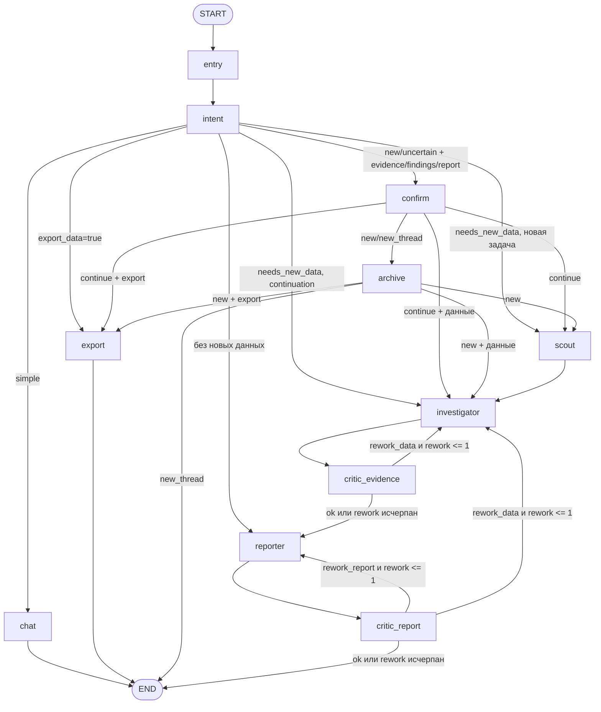

# Устройство и разработка LogiCore Agent

Документ описывает текущую реализацию. При изменении маршрутов, схем состояния,
лимитов или поведения инструментов обновляйте этот файл и `README.md`.

## 1. Компоненты

- **Aegra** загружает граф `agent` из `aegra.json` и каталога `agent/`,
  выполняет runs двумя workers и хранит checkpoints в Postgres.
- **LangGraph** управляет внешним диалогом, continuation, архивацией и rework.
- **LangChain `create_agent`** выполняет приватные tool-циклы скаута,
  инвестигейтора и репортёра.
- **logicore-mcp** предоставляет 12 read-only инструментов поверх Mars API.
- **UI** показывает только публичные сообщения, артефакты и interrupt choice.
- **Phoenix** получает OpenInference/OpenTelemetry-трассировку.

## 2. Внешний граф



Если `CRITIC_ENABLED=false`, переходы `investigator → reporter → END` идут без
критиков. `export` всегда завершается сразу после формирования ответа.

### Назначение узлов

| Узел | Ответственность |
|---|---|
| `entry` | Очищает приватные каналы и run-scoped результаты, не удаляя Evidence текущего расследования |
| `intent` | Возвращает структурированный маршрут и фиксирует окно нового контекста |
| `scout` | Быстрый обзор данных перед основным расследованием |
| `investigator` | Запросы к LogiCore, Evidence и findings |
| `reporter` | Ответ, отчёт и файл на основании Evidence |
| `critic_evidence` | Проверяет достаточность доказательств |
| `critic_report` | Проверяет отчёт и выбирает доработку |
| `export` | Полная выгрузка без LLM |
| `archive` | Сохраняет прежний отчёт файлом перед сменой расследования |
| `confirm` | `interrupt` с вариантами continue/new/new_thread |

## 3. Модули `agent/`

| Файл | Содержимое |
|---|---|
| `graph.py` | Узлы входа, маршрутизация и сборка `StateGraph` |
| `agents.py` | `create_agent`, приватные каналы, structured response, таймауты и узлы трёх агентов |
| `investigation.py` | Intent, heuristic fallback, контекст, архив и подтверждение смены расследования |
| `export.py` | Прямой `extract_data`, Evidence, Markdown-таблица и файл |
| `critics.py` | Прямые структурированные вызовы критиков |
| `progress.py` | Публичный статус, лимиты и suggestion-действия |
| `llm.py` | Модель и схемы `IntentDecision`, `ScoutResult`, `InvestigationResult`, `ReporterResult`, вердиктов |
| `state.py` | `State` внешнего графа и `AgentWorkState` вложенных агентов |
| `tools.py` | MCP tools, нормализация результатов, Evidence, findings и доставка отчётов |
| `prompts.py`, `prompts/` | Динамические блоки и тексты системных промптов |
| `mcp_client.py` | Подключение к streamable-http MCP |
| `reporting.py` | Markdown-артефакты и callback-доставка |

## 4. Intent и continuation

`IntentDecision` содержит:

- `intent`: `simple`, `complex` или `continuation`;
- `needs_new_data`: нужны ли новые запросы к LogiCore;
- `edit_existing_report`: правка готового отчёта без нового анализа;
- `export_data`: механическая полная выгрузка событий;
- `new_investigation`: `continue`, `new` или `uncertain`;
- `window`: явные границы или `last_minutes`.

Основной путь — structured output через function calling с fallback на JSON
mode. Последний резерв — heuristic в `investigation.py`.

При continuation сохраняются `context.id`, границы окна, Evidence и findings.
Для новых данных continuation идёт сразу в investigator, без повторного скаута.
История для подтверждения смены расследования определяется по наличию
`evidence`, `findings` или `last_report`, а не по только что созданному окну.

При `new` или `uncertain` и наличии истории сначала запрашивается выбор.
Архивация выполняется только после подтверждённого перехода:

- `continue` — остаться в текущем расследовании без архивации;
- `new` — архивировать отчёт, создать окно, очистить Evidence/findings,
  `last_report` и старое `inv_summary`;
- `new_thread` — архивировать отчёт, завершить run и предложить новый чат.

Пользовательского выбора бюджета времени нет.

## 5. Сообщения, состояние и Evidence

Публичный `messages` содержит сообщения пользователя и финальные ответы без
`tool_calls`. Tool-циклы хранятся отдельно:

- `scout_msgs`;
- `inv_msgs`;
- `rep_msgs`.

Отдельное `progress` перезаписывается на каждом этапе и содержит состояние,
текст, текущего агента и счётчик вызовов для одной карточки в UI. Middleware
обновляет счётчик после каждого tool call. Поле не передаётся LLM.
`suggestions` содержит обычные follow-up действия после ответа;
в отличие от resume-кнопок interrupt, они создают новое сообщение пользователя.

`normalize_tool_result` фиксирует окно из `context`, преобразует результат MCP
в JSON-строку и добавляет Evidence:

```json
{
  "id": "tool-call-id",
  "tool": "search_events",
  "arguments": {},
  "window": {"from": "...", "to": "..."},
  "status": "ok | partial | error",
  "result": {},
  "error": null
}
```

Это исключает `[object Object]` и сохраняет фактические аргументы для проверки
claims. Evidence извлекается из вложенного состояния дельтами, чтобы не
дублировать прошлые записи.

## 6. Агенты и критики

| Агент | Инструменты | Structured response |
|---|---|---|
| Scout | MCP + `log_finding` | `ScoutResult` |
| Investigator | MCP + findings | `InvestigationResult` |
| Reporter | `save_report`, `send_report`, findings, `extract_data` | `ReporterResult` |
| Critics | Нет инструментов | `CriticEvidence`, `CriticReport` |

Если `structured_response` отсутствует, runtime читает function-call схемы из
сообщений. Для обычного текстового ответа есть fallback в соответствующую
Pydantic-схему с limitation. Повторная попытка выполняется только когда агент
ничего не добавил в приватный диалог.

Критики вызываются напрямую через `model.invoke`, не являются `create_agent` и
не расходуют tool limits агентов.

## 7. Полная выгрузка

При `export_data=true` узел `export`:

1. Берёт текущие `time_from` и `time_to`.
2. Берёт фильтр последнего `extract_data`; если его нет — последний фильтр из
   Evidence.
3. Не наследует старый `max_rows`.
4. Вызывает `extract_data` напрямую, без LLM.
5. Добавляет Evidence и `ReporterResult`.
6. Формирует Markdown-таблицу и прикрепляет файл.

`extract_data` выполняет пагинацию внутри MCP по 100 событий. Повтор страницы
останавливает цикл с `complete=false`. При достижении `max_rows` возвращаются
`complete=false` и `next_page`; продолжение — вызов с `page=next_page` и теми
же окном, фильтром и порядком.

## 8. Лимиты

| Название | Значение и область | Поведение при достижении |
|---|---|---|
| Scout `run_limit` | 10 на `create_agent.ainvoke` | Текущий tool-цикл завершается |
| Investigator `run_limit` | 30 на `create_agent.ainvoke` | Текущий tool-цикл завершается |
| Reporter `run_limit` | 60 на `create_agent.ainvoke` | Текущий tool-цикл завершается |
| `MAX_REWORK` | 1 на внешний run | Дальнейший rework запрещён, run завершается с текущим результатом |
| `LOGIQ_RATE_LIMIT_CALLS` | 300 MCP-вызовов | MCP возвращает ошибку и `retry_after` |
| `LOGIQ_RATE_LIMIT_WINDOW_S` | Скользящие 600 с | Старые вызовы перестают учитываться по времени |
| `extract_data` | 100 строк/страница | Переход на следующую страницу внутри MCP |
| `LOGIQ_EXTRACT_MAX_ROWS` | 1000 по умолчанию | `complete=false`, `next_page` |
| `max_rows` | До 5000 на вызов | Ограничение текущей выгрузки |

### Сброс tool limits

Счётчик принадлежит одному запуску вложенного агента. Он обнуляется при новом
`ainvoke`: новое сообщение, повтор после rework или retry structured response.
Он не суммируется по треду и не обнуляется по таймеру. Прямой `export` лимит
репортёра не расходует.

MCP rate limit — отдельный скользящий лимит процесса MCP, не связанный с
`run_limit` агентов.

## 9. Таймауты

| Таймаут | Значение | Что покрывает |
|---|---:|---|
| `AGENT_TIMEOUT_SECONDS` | 600 с | Один полный `create_agent.ainvoke`, включая LLM и tool-цикл |
| `EXPORT_TIMEOUT_SECONDS` | 120 с | Прямой вызов `extract_data` в `export` |
| `LOGIQ_TIMEOUT_CONNECT` | 5 с | Подключение к Mars API |
| `LOGIQ_TIMEOUT_READ` | 30 с | Чтение ответа Mars API |
| `LOGIQ_SPLIT_BUDGET_S` | 600 с | Внутреннее разбиение тяжёлых запросов MCP |

При таймауте вложенного агента `asyncio.wait_for` отменяет текущий вызов, а
runtime создаёт схемный результат с limitation. Внешний граф может продолжить
работу следующими узлами. При таймауте `export` создаётся Evidence со статусом
`error` и ответ об ошибке.

Это не общий дедлайн чата или расследования. Прямые вызовы `intent`, `chat` и
критиков отдельным agent timeout сейчас не покрыты. Поэтому суммарный run может
быть длиннее 600 секунд.

## 10. Конфигурация

Обязательные секреты и подключение описаны в `.env.example` и `README.md`.
Необязательные параметры агента:

- `CRITIC_ENABLED=true`;
- `MAX_REWORK=1`;
- `AGENT_TIMEOUT_SECONDS=600`;
- `EXPORT_TIMEOUT_SECONDS=120`;
- `LOGICORE_MCP_URL` или `LOGIQ_MCP_URL`;
- `LOGICORE_MCP_TOKEN` или `LOGIQ_API_TOKEN`.

Параметры MCP имеют префикс `LOGIQ_`; актуальные значения —
`logicore-mcp/logicore_mcp/config.py`.

## 11. Тесты

Запуск из корня:

```bash
uv run --with "langchain==1.3.10" --with "langgraph==1.2.16" \
  --with "langchain-openai" --with "pydantic-settings" \
  --with "httpx" --with "tenacity" --with "pytest" --with "loguru" \
  pytest -q tests
```

Тесты используют fake LLM/MCP и настоящий tool-node графа. Покрыты маршруты,
continuation, structured response, Evidence, rework, доставка, tool limits,
таймауты, архив/interrupt, SSE timeline и пагинация.

Перед завершением изменения также выполните:

```bash
git diff --check
docker compose up -d --force-recreate aegra
curl http://localhost:2026/health
```

`--force-recreate` гарантирует, что все Aegra workers загрузят согласованные
версии модулей. Для live-проверки используйте новый тред и реальный API-вызов,
а не только импорт графа.

## 12. Трассировка

Phoenix доступен на http://localhost:6006. Aegra передаёт события через
`PHOENIX_COLLECTOR_ENDPOINT=http://phoenix:6006/v1/traces` и `OTEL_TARGETS=PHOENIX`.
По run/thread можно проверить последовательность LLM-вызовов, tool calls,
структурированные ответы и фактическую длительность этапов.
