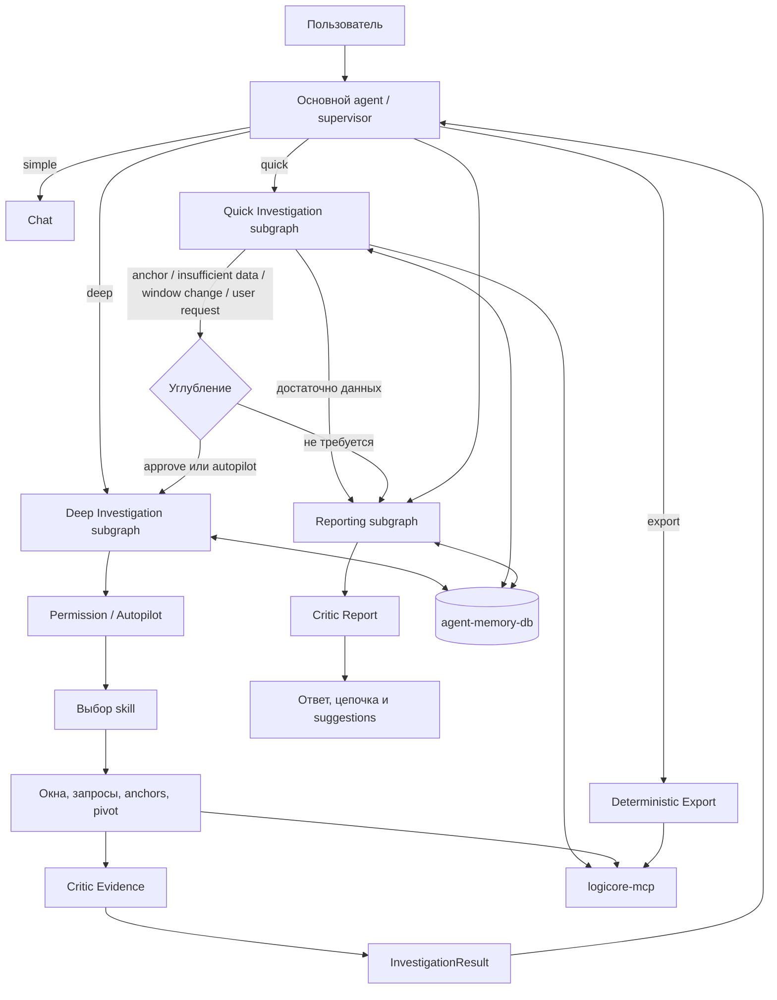

# План: investigation-субграф с навыками, автономными окнами и собственной памятью

Статус: план реализации, а не описание уже существующего поведения.

## 1. Цель

Выделить глубокое расследование из основного агента в самостоятельный
`investigation`-субграф, который:

- поддерживает быстрый (`quick`) и глубокий (`deep`) уровни исследования;
- позволяет переходить между ними без потери контекста;
- работает в режиме подтверждения действий или autopilot;
- самостоятельно меняет, расширяет и смещает окна;
- применяет версионируемые skills;
- хранит историю расследований в отдельной БД;
- возвращает основному агенту компактный структурированный результат.

Отдельный микросервис на первом этапе не создаётся.

## 2. Целевая архитектура



Основной граф отвечает за диалог и финальную подачу. Субграф — за глубокий ход
расследования.

## 3. Уровни исследования

### 3.1. Quick — быстрое исследование

Для ограниченного вопроса с понятным ответом:

- сколько событий;
- что было за последний час;
- топ значений поля;
- есть ли конкретное событие;
- карточка события;
- проверка одной гипотезы.

Характеристики:

- текущее окно;
- обычно 1–3 запроса с небольшим жёстким лимитом;
- один проход без pivot;
- без долговременной памяти;
- быстрая модель;
- короткий ответ с Evidence.

Quick выполняется отдельным узлом основного графа, а не investigation-субграфом.

### 3.2. Deep — глубокое исследование

Для работы, где полный путь заранее неизвестен:

- поиск первого появления;
- анализ причин;
- pivot по сущностям;
- изменение окон;
- несколько гипотез;
- skills и длительная история;
- контроль покрытия и `NOT_CHECKED`.

Deep выполняется в investigation-субграфе.

### 3.3. Переход quick → deep

Переход происходит, если:

- найдена зацепка, требующая проверки за пределами окна;
- пользователь просит углубить;
- данных недостаточно;
- требуется расширить или сместить окно;
- появляется несколько конкурирующих гипотез;
- нужен pivot;
- `partial/error` не позволяет быстро ответить;
- выбран соответствующий skill.

Длинный вопрос или слово «анализ» само по себе не является причиной deep.

В `confirm` углубление требует разрешения, поскольку увеличивает объём работы.
В autopilot оно разрешено только внутри scope.

Пример handoff:

```json
{
  "investigation_id": "case-456 или null",
  "goal": "Исходный вопрос и уточнённая цель",
  "escalation_reason": "anchor | insufficient_data | window_change | user_request",
  "current_window": {},
  "anchors": [],
  "evidence_refs": [],
  "mode": "confirm | autopilot",
  "scope": {}
}
```

### 3.4. Переход deep → quick → deep

Точечный follow-up внутри расследования выполняется как quick-действие того же
случая:

- сколько таких событий было вчера;
- показать событие целиком;
- показать топ поля;
- прислать таблицу.

`investigation_id`, окно, anchors и Evidence сохраняются. После quick-действия
можно продолжить deep.

### 3.5. История глубины

```json
{
  "depth": "quick | deep",
  "depth_history": [
    {
      "from": "quick",
      "to": "deep",
      "reason": "anchor_found",
      "at": "..."
    }
  ]
}
```

## 4. Структура кода

```text
agent/
├── graph.py                    # основной supervisor
├── agents.py                   # общие runtime helpers
├── export.py                   # детерминированный узел, не отдельный субграф
├── progress.py
├── quick/
│   ├── graph.py                # ограниченный quick-цикл
│   └── contracts.py
├── investigation/
│   ├── graph.py                # независимый deep graph
│   ├── state.py
│   ├── contracts.py
│   ├── permissions.py
│   ├── windows.py
│   ├── runtime.py
│   ├── skills/
│   │   ├── registry.py
│   │   ├── incident_dating.py
│   │   ├── entity_pivot.py
│   │   └── event_drilldown.py
│   └── memory/
│       ├── repository.py
│       ├── models.py
│       └── migrations/
└── reporting/
    ├── graph.py                # сборка отчёта и цепочки расследования
    ├── contracts.py
    └── evidence.py             # Evidence bundles и чтение по ID
```

`investigation/graph.py` позже можно отдельно зарегистрировать в `aegra.json`
для scheduled-запусков и anomaly-relay без выделения микросервиса.

## 5. Контракт investigation-субграфа

### Вход

```json
{
  "thread_id": "thread-123",
  "investigation_id": "case-456 или null",
  "goal": "Найти первое появление сбоя",
  "mode": "confirm | autopilot",
  "scope": {
    "skills": ["incident_dating", "entity_pivot"],
    "internet": false,
    "write_operations": false
  },
  "initial_window": {
    "from": "...",
    "to": "..."
  },
  "anchors": []
}
```

### Выход

```json
{
  "investigation_id": "case-456",
  "status": "done | partial | waiting | failed",
  "summary": "Краткий результат",
  "claims": [],
  "anchors": [],
  "current_window": {},
  "window_history": [],
  "skill_runs": [],
  "recommended_export_query": {},
  "limitations": [],
  "not_checked": []
}
```

Основной граф получает только необходимый результат, а не все внутренние
сообщения и шаги.

## 6. Intent и маршрутизация

Добавляются независимые поля:

```json
{
  "work_mode": "quick | deep | export | simple",
  "new_investigation": "continue | new | uncertain",
  "needs_new_data": true,
  "escalation_reason": null
}
```

`continuation` описывает связь с предыдущей задачей, а не уровень глубины.

Примеры:

- «Что было за час?» → `quick`;
- «Найди, когда это началось» → `deep`;
- «Проверь ещё одно поле» → `quick + continue`;
- «Пришли всё таблицей» → `export + continue`;
- «Почему это происходит?» → `deep + continue`, если предмет анализа уже есть.

## 7. Permission framework

### 7.1. Режим confirm

Перед каждым значимым действием:

- применение skill;
- расширение или смещение окна;
- новая pivot-ветка;
- переход quick → deep;
- внешний enrichment;
- любая операция записи.

Подтверждается действие целиком, а не каждый технический tool call.

### 7.2. Режим autopilot

Разрешено автономно:

- read-only запросы;
- изменение окон;
- применение skills из scope;
- переходы quick/deep внутри scope;
- pivot;
- таблицы и локальные отчёты.

Не разрешено автоматически:

- internet с чувствительными данными;
- callback/send;
- изменение статусов;
- любые внешние записи.

Такие действия требуют подтверждения даже в autopilot.

### 7.3. ActionRequest

```json
{
  "id": "action-789",
  "type": "expand_window | run_skill | pivot | escalate | enrich | write",
  "title": "Что собираемся делать",
  "skill_id": "incident_dating",
  "skill_version": 1,
  "window": {},
  "filter_summary": "Кратко и понятно",
  "estimated_calls": 12,
  "risk": "read_only | external | write"
}
```

Ответы:

- `approve` — выполнить;
- `reject` — отклонить и предложить альтернативу;
- `autopilot` — включить автономию в указанном scope.

Решения сохраняются в `case_events`. Повторные approve сами по себе autopilot
не включают.

## 8. Автономная работа с окнами

В состоянии:

- `base_window` — текущая общая область расследования;
- `focus_window` — временный фокус конкретной серии запросов;
- `window_history` — все изменения и их причины.

Правила:

1. Если окно не указано в tool call — используется текущее.
2. Явное окно в tool call уважается и не перезаписывается.
3. Evidence хранит фактическое окно запроса.
4. Временный focus не меняет `base_window` автоматически.
5. Закрепление изменения выполняется через `WindowUpdate`.
6. Изменение окна не создаёт новое расследование и не очищает Evidence.

### WindowUpdate

```json
{
  "action": "preserve | focus | expand | replace",
  "time_from": "...",
  "time_to": "...",
  "reason": "Почему меняем окно"
}
```

Пример:

```text
Последний час → обнаружен сбой → создан anchor →
base_window расширен назад → найдено первое наблюдаемое событие →
focus_window сужен вокруг него
```

`investigation_id` и вся предыстория сохраняются.

## 9. Skills

### 9.1. Формат

Skills — версионируемые playbooks с Pydantic-контрактом:

- `id`, `version`;
- триггеры;
- допустимые tools;
- начальные условия;
- стратегия выбора следующего шага;
- ограничения глубины и вызовов;
- stop rules;
- structured result;
- правила честной интерпретации.

Это не жёсткая последовательность tool calls и не загрузка большого `SKILL.md`
на каждый шаг.

Внешние Agent Skills используются как источники идей. Их progressive disclosure
учитывается, но runtime работает с компактными зарегистрированными определениями.

### 9.2. Первая группа skills

**`incident_dating`**

- якорь от пользователя или предыдущего шага;
- поиск назад через непустые/пустые окна;
- адаптивный размер шага;
- сужение вилки;
- результат «первое наблюдаемое событие»;
- stop по границе, retention, лимиту или diminishing returns.

**`entity_pivot`**

- типизированные anchors: IP, account, host, hash, process;
- visited anchors и дедупликация;
- ограничение глубины и ширины;
- приоритизация веток;
- явные `NOT_CHECKED`;
- новые окна и skills по необходимости.

**`event_drilldown`**

- разбор события по `uuid + timestamp`;
- поля и таксономия;
- чтение сообщения без выдумывания смысла;
- создание anchor для dating или pivot.

Следующая группа:

- `baseline_comparison`;
- `iterative_filter_narrowing`;
- `source_health`.

Старые use-cases и `logicore-anomaly-hunting` используются как источники для
адаптации, а не для буквального переноса. Из Elastic skills берутся абсолютное
время, focused-запросы, baseline, corroboration и ранняя остановка. Из
Anthropic Cybersecurity Skills и Agent Skills Specification — progressive
disclosure, prerequisites, verification и metadata для маршрутизации.

## 10. Собственная БД памяти

Новый независимый контейнер `agent-memory-db`:

- отдельные credentials и volume;
- только Docker-сеть;
- не используется Aegra;
- не содержит Aegra checkpoints.

Таблицы:

| Таблица | Назначение |
|---|---|
| `investigations` | Текущая карточка случая |
| `investigation_windows` | История окон |
| `investigation_anchors` | Якоря и посещённые ветки |
| `case_events` | Tool calls, findings, permissions, errors, verdicts |
| `playbooks` | Версии skills |
| `playbook_runs` | Применения и метрики |

Полные события остаются в LogiCore. В БД — состояние, компактные доказательства
и provenance.

При недоступности БД:

- активное расследование продолжается в state;
- пользователь видит ограничение «память недоступна»;
- Aegra и текущий диалог не падают.

## 11. Модели и структурированный вывод

Модели по ролям:

- intent — быстрая;
- scout/quick — быстрая или средняя;
- investigator/deep — самая сильная;
- reporter — средняя;
- critics — средняя или сильная.

Pydantic-схемы добавляются для:

- `ActionRequest`;
- `WindowUpdate`;
- `Anchor`;
- `SkillDefinition`;
- `SkillRunResult`;
- `Evidence`;
- `Finding`;
- `InvestigationResult`;
- `PermissionDecision`.

Версия модели записывается в `playbook_runs`.

Critic Evidence работает внутри субграфа. Critic Report остаётся в основном
агенте. Ошибка критика обозначается как `critic_unavailable`, а не незаметно
превращается в подтверждение качества.

## 12. UI и progress

Показываются:

- quick/deep;
- режим confirm или autopilot;
- текущий skill и его версия;
- текущее окно;
- текущий якорь;
- счётчик вызовов;
- ожидающее `ActionRequest`;
- причина остановки и `NOT_CHECKED`.

Interrupts:

- показывают конкретное действие;
- переживают F5;
- имеют approve/reject/autopilot;
- защищены от повторного клика;
- не путаются с synthetic breakpoint.

Suggestions после ответа остаются обычными follow-up сообщениями.

## 13. Лимиты

Сохраняются текущие лимиты вложенных агентов:

- scout — 10;
- investigator — 30;
- reporter — 60 на один `ainvoke`.

После critic rework запуск новый, лимит новый.

Skill limits — отдельные ограничения конкретной стратегии. Autopilot не отменяет
ни те, ни другие.

При исчерпании возвращаются:

- достигнутый результат;
- фактическое покрытие;
- `NOT_CHECKED`;
- предложение следующего действия.

Общего пользовательского бюджета времени нет.

## 14. Этапы внедрения по ценности

После каждого этапа система остаётся работоспособной. Следующий этап начинается
только если подтверждена польза предыдущего.

### Этап 1. Правильные quick/deep и окна

**Ценность:** простые вопросы не превращаются в долгое расследование, а при
необходимости агент выходит за пределы исходного часа без потери истории.

Объём:

- `work_mode` и handoff quick ↔ deep;
- `investigation/graph.py`, state и контракты;
- base/focus/history;
- явное окно tool call больше не перезаписывается;
- `WindowUpdate`.

Проверка: quick → deep и deep → quick → deep проходят с сохранением
`investigation_id`, окна и Evidence.

### Этап 2. Полные Evidence и понятный отчёт

**Ценность:** пользователь и критик могут проверить, откуда взялся каждый вывод.

Объём:

- Evidence Store и полный `EvidenceBundle`;
- `get_evidence(id)` для больших результатов;
- цепочка «задача → действия → гипотезы → находки → ограничения → дальше».

Проверка: критик читает полный результат по каждому `evidence_id`, а отчёт не
содержит придуманных шагов.

### Этап 3. Управляемая автономия

**Ценность:** пользователь выбирает между контролем действий и автопилотом, не
нажимая разрешение перед каждым техническим вызовом.

Объём:

- `ActionRequest`;
- confirm/autopilot и scope;
- approve/reject;
- отдельное подтверждение внешних и write-операций;
- настройки `/settings`, `/mode`, `/permission`, `/preset`.

Проверка: в manual действие не начинается до approve, autopilot работает только
внутри scope, F5 не теряет ожидающее действие.

### Этап 4. Первый полезный deep-skill

**Ценность:** агент сам находит первое наблюдаемое событие, а не только анализирует
заданный час.

Объём:

- компактный skill registry и схемы;
- `incident_dating`;
- адаптивные шаги назад, пустые/непустые окна, сужение вилки и stop rules.

Проверка: сценарий «последний час → сбой → первое появление» проходит без нового
расследования и с честной цензуризацией результата.

Этапы 1–4 образуют полноценный MVP.

### Этап 5. Расширение расследования

**Ценность:** агент умеет не только датировать проблему, но и проверять её
события и связанные сущности.

Объём:

- `event_drilldown`;
- `entity_pivot`;
- visited anchors, глубина, дедупликация и `NOT_CHECKED`.

Проверка: нет повторных веток, глубина соблюдается, непроверенные сущности явно
перечислены.

### Этап 6. Память между тредами

**Ценность:** новый чат может опереться на прошлый случай без повторения всей
работы и без показа устаревшего ответа.

Объём:

- отдельная `agent-memory-db`;
- investigations, windows, anchors, case_events, playbooks и playbook_runs;
- поиск связанных случаев;
- контрольный запрос перед использованием прошлого результата;
- degrade-режим при недоступности БД.

Проверка: новый тред находит случай и делает контрольный запрос; отключение БД не
роняет текущее расследование или Aegra.

### Этап 7. Оптимизация стоимости и качества

**Ценность:** система улучшается по измеримым данным, а не самопроизвольно меняет
промпты и skills.

Объём:

- модели по ролям и пресеты;
- метрики `playbook_runs`;
- сравнение версий skills по времени, вызовам и качеству Evidence;
- активация новых версий только после проверки.

Проверка: можно сравнить две версии одного skill на одинаковых сценариях и
увидеть причину выбора победителя.

## 15. Приёмочные сценарии

1. **Обычный диалог:** приветствие и быстрый lookup работают без investigation-субграфа.
2. **Quick:** ограниченный вопрос решается без deep и без долговременной памяти.
3. **Quick → deep:** зацепка, окно, Evidence и scope сохраняются.
4. **Deep → quick → deep:** точечный follow-up не создаёт новый случай.
5. **Manual window expansion:** до approve запросов нет; после approve действие выполняется.
6. **Reject:** действие не выполняется, предлагается альтернатива.
7. **Autopilot dating:** агент сам выходит за пределы часа, сохраняя `investigation_id` и Evidence.
8. **Pivot:** нет повторного посещения сущностей, глубина соблюдается, непроверенные ветки перечислены.
9. **Write operation:** требует подтверждения даже в autopilot.
10. **Refresh:** показывается настоящее ожидающее действие.
11. **Новый тред:** прошлый случай найден, но перед использованием сделан контрольный запрос.
12. **Лимит:** результат частичный, `NOT_CHECKED` явный; после rework лимит нового запуска восстановлен.
13. **Memory DB down:** расследование продолжается, Aegra не затронут.
14. **Export:** использует `recommended_export_query` из результата субграфа.
15. **Skill version:** в отчёте и БД видно, какая версия применялась.

## 16. Что не входит в первую версию

- отдельный микросервис расследования;
- автоматическая генерация и активация новых skills;
- импорт всей библиотеки сторонних skills;
- выполнение сторонних scripts;
- internet-enrichment;
- vector search похожих случаев;
- внешние записи без подтверждения.

## 17. Источники для адаптации

- Старые `logicore/docs/use-cases/` и `logicore-anomaly-hunting`.
- [Elastic Agent Skills](https://github.com/elastic/agent-skills).
- [Anthropic Cybersecurity Skills](https://github.com/mukul975/anthropic-cybersecurity-skills).
- [Agent Skills Specification](https://agentskills.io/specification).

## 18. Настройка агента из чата

Настройки выполняются детерминированным обработчиком команд до основного intent,
а не через LLM:

```text
Сообщение начинается с "/"
→ обработчик команд
→ обновление preferences в state
→ подтверждение настройки в чате

Обычное сообщение
→ обычный intent и граф
```

Команды первой версии:

- `/help` — список команд;
- `/settings` — панель настроек с кнопками;
- `/mode quick` и `/mode deep` — уровень исследования;
- `/permission confirm` и `/permission autopilot` — режим разрешений;
- `/preset fast`, `/preset balanced`, `/preset thorough` — наборы моделей;
- `/status` — текущие режим, модель, окно, skill и tool usage;
- `/new` — новое расследование с архивированием текущего.

Пример состояния:

```json
{
  "preferences": {
    "work_mode": "quick",
    "permission_mode": "confirm",
    "model_preset": "balanced",
    "enabled_skills": ["incident_dating", "entity_pivot"]
  }
}
```

Пресеты моделей:

- `fast` — дешёвые модели почти везде;
- `balanced` — быстрый intent, сильный investigator;
- `thorough` — сильные investigator и critics.

Изменения применяются к следующему запуску, а не задним числом к текущему.
Runtime выбирает модель по роли только из whitelist.

Из чата нельзя менять API keys, base URL, произвольные системные промпты, права
доступа, отключать все ограничения или активировать сторонние scripts.
Внешние записи всегда требуют подтверждения.

Обработчик команд реализуется вместе с permission framework. Приёмка включает
проверку, что команды не проходят через LLM, настройки применяются к следующему
run, сохраняются после F5 и не меняют текущее действие задним числом.

## 19. Сначала штатные LangChain/LangGraph primitives

Перед реализацией собственного механизма проверяется официальная функциональность:

- tool loops и ролевые агенты — `create_agent`;
- лимиты — `ToolCallLimitMiddleware`;
- подтверждения конкретных write tools — `HumanInTheLoopMiddleware`;
- действия уровня расследования — собственный `ActionRequest + interrupt`,
  потому что окна, skills и quick → deep не являются отдельными tool calls;
- long-term memory — `BaseStore` / `PostgresStore` в собственной БД;
- checkpoints треда — существующая Aegra, без дублирования;
- суммаризация истории — `SummarizationMiddleware`;
- структурированные ответы — `with_structured_output` и `create_agent`.

Ручной structured response fallback подлежит отдельному пересмотру и упрощению,
а не дальнейшему расширению.

Skill runtime остаётся небольшим: Pydantic-контракт, registry, выбор и запуск
skill, версия и stop rules. Свой пакетный менеджер и Agent Skills runtime не
создаются.

## 20. Специализированные субграфы

Субграфами становятся не все функции, а подсистемы с собственным жизненным
циклом, состоянием и контрактом:

- **Quick Investigation** — ограниченный цикл из нескольких запросов, quick
  handoff и собственный бюджет;
- **Deep Investigation** — permissions, skills, окна, pivot, memory и Critic
  Evidence;
- **Reporting** — выбор Evidence, построение цепочки, финальный ответ, Critic
  Report и артефакты.

Chat, intent, deterministic export и простые маршрутные функции остаются узлами
основного графа. Выделение отдельного графа ради одного вызова не требуется.

Каждый субграф имеет независимые вход, выход, состояние, модель и тесты. Основной
supervisor не дублирует их внутреннюю работу.

## 21. Evidence и работа критика

### 21.1. Что означает evidence_id

`evidence_id` — это не доказательство само по себе, а уникальная ссылка на
запись конкретного вызова. Claim со списком `evidence_ids` означает: «это
утверждение подтверждается содержимым именно этих записей».

Критик должен проверять не только существование ID, но и соответствие утверждения
фактическим аргументам, окну, статусу и результату.

### 21.2. Текущая проблема

Сейчас результаты сохраняются в `state.evidence` и checkpoint треда, но критик
получает их через `evidence_block`: только первые несколько событий большой
выдачи и ограниченный по размеру JSON. Поэтому для больших результатов критик
работает не всегда с полными данными.

### 21.3. Evidence Store

Добавляется единая схема:

```json
{
  "id": "tool-call-id",
  "investigation_id": "case-456",
  "step_id": "step-12",
  "tool": "search_events",
  "arguments": {},
  "window": {},
  "status": "ok | partial | error",
  "complete": true,
  "result_preview": {},
  "result_ref": "evidence://case-456/tool-call-id",
  "created_at": "..."
}
```

- В active state остаются ссылки и компактные previews.
- Полный JSON результата доступен через Evidence Store.
- Для deep-случаев полные записи персистируются в собственной БД/Store.
- Evidence Store не дублирует LogiCore как хранилище событий: при необходимости
  исходное событие можно повторно прочитать по `uuid + timestamp`.

Для критика и репортёра формируется полный `EvidenceBundle` всех релевантных
записей без скрытого усечения. Для больших записей доступен локальный read-only
`get_evidence(id)`. Это не MCP-запрос к LogiCore и не write tool.

Проверка claims выполняется по цепочке:

```text
claim → evidence_id → полная Evidence → аргументы/окно/результат
```

## 22. Итоговая цепочка расследования

Reporting-субграф формирует не только краткий ответ, но и полноценный отчёт
аналитика на основе `case_events` и Evidence.

Структура:

1. **Исходная задача** — запрос, цель, quick/deep, permission mode.
2. **Начальная область** — окно, фильтры, anchors.
3. **Ход расследования** — значимые действия в хронологии, включая смену окон,
   quick/deep-переходы и решения пользователя.
4. **Гипотезы** — `open | supported | rejected`, с Evidence ID для каждой.
5. **Находки** — факты, числа и ссылки на Evidence.
6. **Вердикт** — вывод и уровень уверенности.
7. **Ограничения** — partial/error, retention, таймауты и лимиты.
8. **NOT_CHECKED** — что именно не проверено и почему.
9. **Дальнейшие действия** — конкретные suggestions и рекомендуемый export.

Пример логики отчёта:

```text
Начали с последнего часа → обнаружили повторяющийся сбой →
сформировали H1/H2 → расширили окно → H2 отклонена по count=0 →
H1 подтверждена конкретными Evidence → нашли первое наблюдаемое событие →
проверили связанные сущности → указали оставшиеся пробелы
```

Хронология и ссылки создаются детерминированно из `case_events`; LLM может
только сформулировать summary и не вправе добавлять новые действия или факты.

Пользователь получает:

- краткий ответ в чате;
- развёрнутую цепочку расследования;
- Markdown-отчёт;
- машиночитаемый JSON при необходимости.

Это не SQL-дамп и не поток внутренних tool-сообщений, а связный отчёт аналитика
с доказательной базой и явными пробелами.

Приёмка дополнительно проверяет, что критик может прочитать полный результат по
каждому `evidence_id`, а итоговая цепочка соответствует фактическим событиям без
придуманных шагов.

## 23. Scout, Reporting и Critic

**Scout превращается в Quick Investigation**, а не расширяется в ещё одного
исследователя. Он делает 1–3 проверки, возвращает `answer_candidate`, anchors,
coverage и `escalation.needed/reason/suggested_skill`.

**Reporting выделяется в субграф**: полный EvidenceBundle, детерминированная
хронология, краткий ответ, полный отчёт, claims, limitations, `NOT_CHECKED`,
`recommended_export_query` и suggestions. LLM формулирует текст, но не придумывает
ход расследования.

**Critic остаётся checkpoint внутри quick/deep/reporting**, а не отдельным графом.
Сначала детерминированные проверки ID, окна, status и покрытия, затем семантическая
проверка через LLM. Результат содержит `issues` с claim/evidence IDs, причиной и
`suggested_action`. Ошибка критика даёт `critic_unavailable`, а не скрытый `ok`.

## 24. Intent

Intent усиливается точечно, без отдельного субграфа:

- сначала детерминированные `/`-команды и очевидные правила;
- затем быстрая модель со structured output;
- поля `work_mode`, `new_investigation`, `needs_new_data`, `window_request`,
  `escalation_reason` и `confidence`;
- clarification только при реальной неоднозначности;
- детерминированный fallback без повторного «думающего» агента.

Intent только маршрутизирует и не строит расследование.

## 25. Предпочтения и аутентификация

Предпочтения двух уровней:

- state треда — текущие quick/deep, permission, окно и модель;
- `user_preferences` в собственной БД — постоянные defaults пользователя.

Настройки треда переопределяют пользовательские defaults. `/settings` меняет state
сразу и сохраняет предпочтение для следующих тредов. Секреты там не хранятся.

Для multiuser используется существующий OIDC/OAuth-провайдер, а не свой IdP:

- UI получает JWT у провайдера;
- Aegra/custom auth проверяет подпись, issuer, audience и expiry;
- `user_id` берётся только из проверенного токена, не из параметров UI;
- доступ к тредам, случаям, Evidence и preferences проверяется по `user_id`;
- anomaly-relay использует отдельный service token.

Текущий anonymous-режим остаётся только для локальной разработки. Перед multiuser
он должен быть явно выключен.

Итог: основной агент становится диспетчером, быстрые вопросы решаются легко, а
глубокое расследование получает отдельную подсистему с разрешениями, автономными
окнами, версионируемыми skills, полными Evidence, понятным отчётом и собственной
долговременной памятью.
