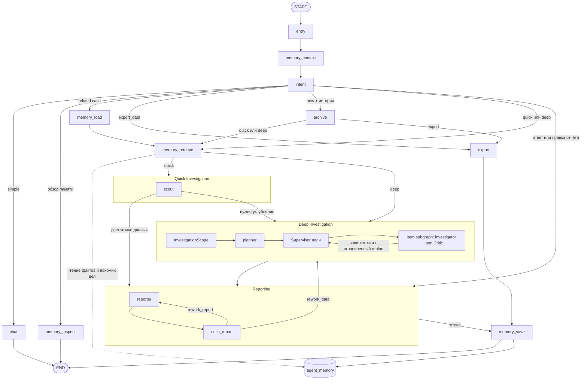
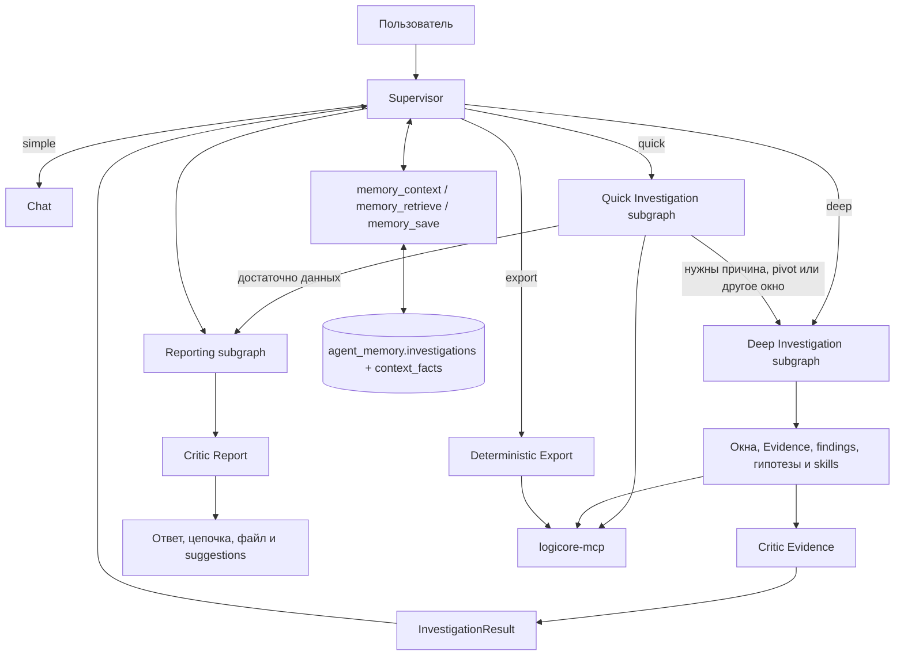

# LogiCore Agent

Многоагентная система для анализа событий LogiCore. LangGraph управляет диалогом,
LangChain выполняет приватные tool-циклы агентов, MCP-сервер читает данные через
Mars API, Aegra предоставляет API и checkpoints, Phoenix собирает трассировку.

Документы разделены по назначению:

- **этот README** — что работает сейчас и как запустить;
- [DEV.md](docs/DEV.md) — полное руководство по работе и устройству агента;
- [logicore-mcp/README.md](logicore-mcp/README.md) — handoff MCP: запуск, контракты,
  IQL, ограничения и приёмочные сценарии;
- [ROADMAP.md](docs/ROADMAP.md) — только планируемые доработки и их приёмочные сценарии;
- [EVALUATION.md](docs/EVALUATION.md) — фоновая оценка runs по Phoenix;
- [OBSERVABILITY.md](docs/OBSERVABILITY.md) — текущая интеграция Phoenix, metadata и retention;
- [AGENTS.md](AGENTS.md) — правила внесения изменений.

## Что работает сейчас

- Персона LogiCore Investigator: объясняет, как и почему устроена его работа,
  и вежливо отказывается отвечать на темы вне расследований LogiCore.
- Обычный чат в пределах специализации без обращения к LogiCore.
- Структурированный intent: simple, complex, continuation, export и выбор
  `work_mode=quick/deep`.
- Quick строит статистический снимок через scout → reporter: объём, динамику,
  распределения, заполненность полей и дубликаты. Intent направляет сюда количественный
  анализ, проверку поступления данных и сравнение двух окон. Сырые события используются
  только для точечных примеров; причины аномалий и pivot остаются в deep.
- Deep начинается со structured `InvestigationScope`: Discovery (обзор до 2 проверок),
  Targeted (конкретная ветка) или Alert (SIEM-алерт). Required и optional разделены:
  следующие направления не раздувают текущий план.
- Planner разбивает только включённую работу на 1–5 work items с `acceptance`,
  приоритетом и стоимостью. Supervisor выполняет зависимые волны через item-subgraphs
  и `asyncio.gather` (до 2 веток), с Item Critic и retry. Replan допустим только при
  невыполненном acceptance, ошибочном выводе или отсутствии критического Evidence.
- Skills `incident_dating`, `event_drilldown` и `entity_pivot` v1 автоматически
  выбираются по задаче. Есть адаптивные окна, разбор `uuid + timestamp`, typed
  anchors, дедупликация `type:value`, ограничения глубины/ширины и `NOT_CHECKED`.
- Поиск, подсчёт и агрегаты через 12 read-only MCP-инструментов. Фильтры принимаются
  как готовый `iql` и передаются в MARS напрямую, без JsonLogic-трансляции.
- Отдельные Quick, Deep Investigation и Reporting-субграфы с delta-границей,
  которая не дублирует additive state в supervisor.
- Приватные tool-циклы scout, investigator и reporter через `create_agent` и
  `SummarizationMiddleware` для длинной истории.
- Собственная `agent-memory-db`: Case Store в предметной таблице дел и Context Memory
  атомарных фактов с provenance, pgvector-поиском и консолидацией после расследования.
  Восстановление дела в новом треде требует контрольного запроса к LogiCore.
- Отдельный `search_similar_cases` находит компактные карточки похожих дел без
  continuation и подмены текущих Evidence.
- Read-only обзор памяти по запросу «что ты помнишь?»: текущее дело, активные
  факты с TTL и последние случаи; инструмент `inspect_memory` доступен и другим ролям.
- Журнал гипотез `open/supported/rejected` с историей, Evidence ID и отображением
  в детерминированной цепочке отчёта.
- Pydantic-контракты Evidence/Finding, расширенные Scout/Intent/Reporting и
  структурированные `issues` критиков с `suggested_action`.
- Модели по ролям через env; `model` и фактическая `duration_ms` в `skill_runs`.
- Метрики `run_metrics` по ролям и items: длительность, токены, tool calls по типам,
  повторные запросы и continuations. Они попадают в Case Store, manifest и MCP.
- Phoenix annotations, 24 golden-сценария и штатные Datasets/Experiments для сравнения
  моделей и версий промптов; локальная validation не запускает живые runs.
- `Evidence` с фактическими аргументами, окном, статусом и результатом вызова.
  Явные `time_from/time_to` запроса не перезаписываются контекстом.
- Компактный обзор Evidence для агентов, полный `Evidence Bundle` по claims для
  критика и локальный `get_evidence(id)` без повторного MCP-запроса.
- Детерминированная цепочка «задача → вызовы → окна → режимы → находки →
  ограничения → NOT_CHECKED» автоматически добавляется в файлы отчётов.
- Проверяемый ZIP-пакет расследования: `report.md`, фактические IQL/JSON-запросы,
  `evidence.jsonl`, `events.csv` и `manifest.json` с индексом Evidence, журналом
  памяти и SHA-256. В отчёте видно, какие факты LLM предложила, сохранила или отклонила.
- SeaweedFS/S3-хранение файлов по ключам `investigations/<case>/<run>/<file>`;
  в state остаются метаданные, в чат и callback выдаются подписанные URL с TTL.
- Асинхронный MCP-интерфейс самого агента: старт, статус, результат, отмена и
  получение Evidence без ожидания долгого run и без base64 в structured JSON.
- Структурированные ответы агентов и критиков с текстовым fallback. Сбой критика
  обозначается как `critic_unavailable`, а не маскируется под `ok`.
- Continuation с сохранением `context.id`, `base_window`, `focus_window`,
  `window_history`, `depth_history`, Evidence и findings.
- Полный автопилот без подтверждений, resume и slash-команд. Явная новая тема
  автоматически архивирует прежний отчёт; неоднозначная — продолжает текущий случай.
- Детерминированный `extract_data`: серверная пагинация, таблица и Markdown-файл
  без генерации сотен строк через LLM.
- Короткие уведомления в чате через одну карточку `progress`: quick/deep, смена
  этапа или окна и счётчик вызовов. Служебные сообщения не попадают в `messages`.
- Suggestion-кнопки после ответа.
- Трассировка в project `logicore-agent` Phoenix с role/mode/work-item metadata,
  постоянным хранилищем и retention 30 дней; read-only MCP без code execution.
- Фоновый `agent-evaluator`: независимая оценка завершённого run по state и trace,
  хранение в `agent_memory.run_evaluations` и отложенное уведомление «Автодиагностика» в треде.

Multiuser/OIDC намеренно не реализуется. Текущий anonymous-режим предназначен
только для локальной разработки.

## Сервисы

| Сервис | Порт | Назначение |
|---|---:|---|
| `aegra` | 2026 | LangGraph/Aegra API, workers и checkpoints |
| `agent-chat-ui` | 3000 | Веб-чат на Next.js |
| `agui-agent` | 2027 | AG-UI адаптер и control API поверх Aegra runs, без второго графа |
| `copilotkit-demo` | 3001 | CopilotKit-рабочий стол аналитика поверх общих Aegra threads |
| `logicore-mcp` | 9000, только Docker-сеть | 12 read-only MCP-инструментов |
| `agent-mcp` | 9100 | Асинхронный MCP-интерфейс расследований |
| `agent-evaluator` | 9200, только Docker-сеть | Фоновая оценка завершённых runs |
| `seaweedfs` | 8333 | S3-файлы отчётов и пакетов Evidence |
| `anomaly-relay` | 2025 | Webhook LogiCore → тред и run |
| `postgres` | 5432 | Состояние Aegra, не отдельная память случаев |
| `agent-memory-db` | только Docker-сеть | Case Store, Context Memory и журнал исполнения в `agent_memory`, pgvector |
| `redis` | 6379 | Очередь задач и SSE-брокер |
| `phoenix` | 6006 | OpenInference/OpenTelemetry-трассировка |

### AG-UI copilot

`agui-agent` (порт 2027) преобразует AG-UI запросы в Aegra runs API и возвращает
`RUN_*`, `STEP_*`, `TEXT_MESSAGE_*`, `TOOL_CALL_*`, `STATE_SNAPSHOT` и `RAW`.
Собственного графа и `InMemorySaver` у адаптера нет: CopilotKit и основной чат
используют общие Aegra threads, runs и PostgreSQL checkpoints. После перезагрузки
страницы состояние восстанавливается, активный run подключается повторно без нового
запуска. `copilotkit-demo` (порт 3001) — рабочий стол аналитика с отдельной панелью чата.

Вкладка «Обзор» содержит текущую задачу, KPI, план, гипотезы, находки, метрики и
компактное дерево «этап → вызовы». Есть поиск, фильтр проблем, сворачивание веток
и постраничное раскрытие длинных списков. «Агенты и граф» показывает топологию
supervisor и субграфов, фактические system prompts, входные сообщения и приватные
tool-циклы ролей. Prompts сохраняются в `agent_memory.execution_events` вне
checkpoint, чтобы не раздувать состояние графа.

«Пауза и откат» использует Aegra control API: ручная остановка, resume,
`interrupt_after` для пошагового режима, история checkpoints и ветвление от выбранного
состояния без удаления истории. Задача, pending work items и prompt override меняются
через валидированные формы, а не произвольный JSON. Отдельный opt-in останавливает
Scout/Investigator/Reporter перед tool calls; обязательных approval-интерраптов нет.
Ручные read-only MCP-вызовы доступны только на паузе и сохраняются как обычные
`EvidenceRecord`. «Скорректировать ход» по-прежнему отправляет follow-up после
текущего run, не меняя выполняющийся граф.

«Запросы и доказательства» показывает таблицы результатов, фактические аргументы,
IQL и окна. LogiCore возвращает IQL, не SQL. «Итоговый отчёт» рендерит Markdown,
claims, ограничения и файлы отчёта. План реализации и приёмочные сценарии —
[AG_UI_COPILOT_PLAN.md](docs/AG_UI_COPILOT_PLAN.md).

Для правок демо без пересборки образа: `docker compose stop copilotkit-demo`, затем
`cd copilotkit-demo && npm install && COPILOTKIT_TELEMETRY_DISABLED=true npm run dev` —
та же страница на :3001, но с hot reload. Docker-стенд пересобирается только после
завершения серии правок: `docker compose up -d --build copilotkit-demo`.

## Запуск

Требуется Docker с Compose v2:

```bash
cp .env.example .env
# Заполнить .env
docker compose up -d --build
```

Основные переменные:

- `LLM_BASE_URL`, `LLM_TOKEN`, `LLM_MODEL` — OpenAI-совместимый провайдер;
- `LLM_MODEL_INTENT/SCOUT/INVESTIGATOR/REPORTER/CRITIC/MEMORY/EVALUATOR/PLANNER` — необязательные модели по ролям;
- `INVESTIGATION_PLANNER_ENABLED`, `PLANNER_MAX_ITEMS/PARALLEL/REVISIONS` — декомпозиция Deep;
- `SCOPE_DISCOVERY_MAX_ITEMS=2`, `SCOPE_REQUIRED_MAX_ITEMS=2` — границы этапа;
- `AGENT_PROMPT_VERSION` — версия промптов в Phoenix metadata и Experiments;
- `EVALUATOR_ENABLED/POLL_SECONDS/THREAD_LIMIT/TRACE_ATTEMPTS` — фоновая оценка runs;
- `EVALUATOR_TRACE_ATTRIBUTE_LIMIT`, `EVALUATOR_PHOENIX_ANNOTATIONS_ENABLED` — размер контекста и annotations;
- `SUMMARIZATION_TRIGGER_TOKENS`, `SUMMARIZATION_KEEP_MESSAGES` — суммаризация истории;
- `AGENT_TOOL_LIMIT_SCOUT/INVESTIGATOR/REPORTER`, `AGENT_TIMEOUT_SECONDS`,
  `EXPORT_TIMEOUT_SECONDS`, `MAX_REWORK` — лимиты и таймауты;
- `CRITIC_MESSAGE_LIMIT`, `CRITIC_DIALOG_LIMIT`, `REPORT_INJECT_LIMIT` — размеры контекста;
- `LOGIQ_URL`, `LOGIQ_USER`, `LOGIQ_PASSWORD`, `LOGIQ_TLS_VERIFY` — LogiCore;
- `LOGIQ_API_TOKEN` — авторизация MCP streamable-http;
- `POSTGRES_PASSWORD` — пароль Postgres Aegra;
- `AGENT_MEMORY_POSTGRES_PASSWORD`, `AGENT_MEMORY_RECENT_LIMIT` — отдельная память;
- `AGENT_MEMORY_SCOPE`, `AGENT_MEMORY_RETRIEVAL_LIMIT`, `AGENT_MEMORY_CASE_RETRIEVAL_LIMIT`,
  `AGENT_MEMORY_SIMILARITY_THRESHOLD` — область и параметры поиска Context Memory и похожих дел;
  `AGENT_MEMORY_OBSERVED_TTL_HOURS=24` — TTL наблюдений;
- `AGENT_MEMORY_EMBEDDING_MODEL=bge-m3`, `AGENT_MEMORY_EMBEDDING_DIMENSIONS=1024` —
  embeddings; отдельные `AGENT_MEMORY_EMBEDDING_BASE_URL/TOKEN` необязательны;
- `ARTIFACT_S3_*`, `ARTIFACT_SIGNED_URL_TTL_SECONDS` — S3 и срок действия ссылок;
- `AGENT_MCP_TOKEN` — Bearer-авторизация внешнего MCP агента;
- `RELAY_TOKEN`, `DEFAULT_CALLBACK_URL` — опциональные webhook/отчёты;
- `DEPLOY_HOST/USER/PASSWORD/GIT_URL/REMOTE_PATH` — опциональный `scripts/deploy_ma.py`.
  Все значения по умолчанию и дополнительные лимиты перечислены в `.env.example`.

После запуска:

- чат: http://localhost:3000;
- API: http://localhost:2026;
- Phoenix: http://localhost:6006;
- webhook: `http://<хост>:2025/anomaly`.

Проверка:

```bash
docker compose ps
curl http://localhost:2026/health
```

Anonymous-режим подходит только для локальной разработки.

## MCP агента

Endpoint: `http://localhost:9100/mcp`, заголовок `Authorization: Bearer $AGENT_MCP_TOKEN`.
Вызовы возвращаются сразу; долгий run продолжается в Aegra:

- `investigation_start(task, window?, mode?, scope_mode?, alert?)` → `investigation_id`;
- `investigation_status(investigation_id)` → этап, Scope, готово X/Y и ошибки;
- `investigation_result(investigation_id)` → отчёт, claims, метрики, память и свежие S3-ссылки;
- `investigation_continue(investigation_id, message, ...)` → следующий этап в том же треде;
- `investigation_restart(investigation_id)` → повтор последнего запроса после отмены/ошибки;
- `investigation_evidence(investigation_id, evidence_id?)` → полные Evidence;
- `investigation_cancel(investigation_id)` → отмена активного run.

Адаптер использует существующий граф и runs API. Доступ разрешён только к созданным
через него тредам `inv-*`; второго investigation engine или task manager нет. TypedDict
output schemas и `structuredContent` создаются штатным MCP SDK; параллельный continuation
и base64 в ответе запрещены, ошибки содержат `error_code` и `retryable`.

## Текущий граф



При `CRITIC_ENABLED=false` критики пропускаются. `export` не вызывает LLM и не
проходит критиков.

Публичный `messages` содержит сообщения пользователя, финальные ответы и
детерминированные уведомления `scope`/`planner`, статистический отчет Scout,
находки, смены окон и статусы гипотез.
Agent Chat UI получает `updates` и объединяет их по message ID через единый reducer:
публичные сообщения не исчезают при смене субграфа, приватные tool-циклы не отображаются.
Tool-циклы остаются в `scout_msgs`, `inv_msgs`, `rep_msgs`. Аудит памяти не создаёт
отдельный AI-ответ; обновлённые файлы прикрепляются к исходному ответу Reporter.

`memory_retrieve` ищет до пяти релевантных фактов и до трёх похожих дел при старте
quick/deep. Scout и investigator могут повторить поиск через `search_context_memory`
и `search_similar_cases` при появлении новых сущностей. Похожие дела возвращаются
компактными карточками и не становятся continuation. После ответа `memory_save`
записывает дело в `agent_memory.investigations`,
а structured LLM-шаг предлагает операции `insert/update/supersede/ignore` для атомарных
фактов в `agent_memory.context_facts`. Подтверждённые investigation-факты без валидных
Evidence отклоняются; найденный контекст не подменяет свежие запросы к LogiCore.
Явная команда «запомни» маршрутизируется через `remember_fact` в Reporter и `memory_save`,
а не в обзор памяти; пользовательский факт сохраняется без Evidence и на новом треде.

Подробности состояния и маршрутов — в [DEV.md](docs/DEV.md).

## Субграфы и память (реализовано)

Логическая схема подсистем и внешних хранилищ:



Quick и deep используют общие Evidence и handoff, но имеют разные бюджеты,
модели и жизненный цикл. Полные контракты находятся в [DEV.md](docs/DEV.md).

## Лимиты и таймауты

Пользовательского бюджета времени и вопросов о нём нет.

| Ограничение | Значение |
|---|---:|
| Tool calls скаута за один `ainvoke` | 10 |
| Tool calls инвестигейтора за один `ainvoke` | 30 |
| Tool calls репортёра за один `ainvoke` | 60 |
| Таймаут одного вложенного `create_agent.ainvoke` | 600 с |
| Таймаут узла `export` | 120 с |
| Возвраты на доработку за внешний run | 1 |
| Work items / параллельные ветки | 5 / 2 |
| Discovery items / обязательные items | 2 / 2 |
| Optional-направления следующего этапа | до 3 |
| Продолжения после tool limit на item | 1 |
| Версии плана | 2 |
| Строк на страницу `extract_data` | 100 |
| Строк в `extract_data` по умолчанию | 1000 (`LOGIQ_EXTRACT_MAX_ROWS`) |
| Допустимый `max_rows` одного вызова | 1–5000 |
| MCP rate limit | 300 вызовов за скользящие 600 с |

`run_limit` сбрасывается при каждом новом запуске соответствующего агента:
новое сообщение, rework или retry structured response. Это не общий лимит чата.
Autopilot не отменяет эти ограничения.

У Scout 10 выполненных вызовов на один запуск, без continuation. Investigator и
Reporter после tool limit автоматически продолжают работу новым итерационным шагом
в том же run с обновлённым `run_tool_call_count` и сохранённым handoff. По умолчанию
доступно 1 продолжение (`AGENT_MAX_CONTINUATIONS`). Только после их исчерпания
отдельный LLM-вызов без инструментов формирует результат с limitation; служебный
текст middleware не становится ответом. Evidence читаются пакетно.
Таймаут одного агента не ограничивает длительность всего run:
прямые вызовы intent, chat и критиков отдельным таймаутом сейчас не покрыты.

## Текущие ограничения и велосипеды

Не весь собственный код является велосипедом: Evidence, окна, anchors, pivot,
`extract_data`, `progress` и отчёты относятся к предметной логике. Но есть явные
места для исправления.

| Место | Проблема сейчас | Как исправлять |
|---|---|---|
| Structured response fallback | Ручной function-call parser удалён; остаётся только явный текстовый fallback в схему | Проверять необходимость fallback на живом провайдере, не восстанавливать собственный parser |
| Метрики skills | `model`, `duration_ms`, Evidence и окна сохраняются в `skill_runs` и памяти | Использовать для наблюдаемости; сравнение версий skills не требуется |

## Реализованные этапы

1. **Quick/deep и автономные окна** — отдельные субграфы.
2. **Полные Evidence и цепочка расследования** — state, отчёты и память.
3. **Понятный автопилот** — короткие уведомления без подтверждений и slash-команд.
4. **Skills** — `incident_dating`, `event_drilldown`, `entity_pivot` с метриками.
5. **Расширенные контракты и гипотезы** — Evidence/Finding, Scout, Intent, Critic issues,
   `open/supported/rejected` с историей.
6. **Case Store + Context Memory + похожие дела** — собственные таблицы, pgvector,
   консолидация, continuation и `search_similar_cases`.
7. **Модели и метрики** — модели по ролям, `model`/`duration_ms`; сравнение версий
   skills по решению не выполняется.
8. **Проверяемые отчёты** — фактический IQL, ZIP с Evidence и аудит памяти.
9. **S3-артефакты** — SeaweedFS, object keys и обновляемые signed URL.
10. **MCP агента** — structuredContent, continuation/restart, отчёты, Evidence и отмена.
11. **Scope и ограниченный Planner** — Discovery/Targeted/Alert, acceptance и optional.
12. **Метрики и качество** — run/item metrics, Phoenix annotations и 24 golden-сценария.
13. **Упрощение архитектуры** — общие state-каналы, skill runtime и единый artifact service.

Этапы 1–4 образуют MVP. Архитектура, контракты и приёмочные сценарии —
[DEV.md](docs/DEV.md).

## Структура проекта

```text
├── agent/
│   ├── graph.py           # supervisor и маршруты
│   ├── quick_graph.py     # Quick Investigation subgraph
│   ├── investigation_graph.py # Deep и item-subgraphs
│   ├── scope.py           # InvestigationScope и режимы этапа
│   ├── planner.py         # acceptance, зависимости, волны и агрегация
│   ├── reporting_graph.py # Reporting subgraph
│   ├── subgraph.py        # delta-граница субграфов
│   ├── agents.py          # runtime scout/investigator/reporter
│   ├── skill_runtime.py   # проверка skill_run и anchors
│   ├── investigation.py   # intent, quick/deep, окна и автоархивация
│   ├── memory.py          # Case Store и консолидация Context Memory
│   ├── memory_models.py   # схемы дел, фактов и операций
│   ├── memory_store.py    # предметные таблицы и pgvector-поиск
│   ├── artifact_store.py  # S3-ключи и подписанные ссылки
│   ├── artifacts.py       # единый сервис Markdown/ZIP
│   ├── metrics.py         # длительность, токены и tool calls
│   ├── contracts.py       # Evidence, Scope, WorkItem, Finding, CriticIssue, Hypothesis
│   ├── export.py          # детерминированная таблица и файл
│   ├── critics.py         # критики доказательств и отчёта
│   ├── evidence.py        # Evidence Bundle и цепочка расследования
│   ├── progress.py        # статус, лимиты и suggestion-действия
│   ├── llm.py             # LLM и Pydantic-схемы ответов
│   ├── execution_audit.py # фактические model inputs вне checkpoints
│   ├── control_overrides.py # run-scoped prompt overrides
│   ├── step_mode.py       # opt-in пауза перед tool calls
│   ├── state.py           # общие Evidence/Case/Memory Channels
│   ├── tools.py           # MCP tools, Evidence и findings
│   ├── skills/            # registry, контракты и playbooks
│   └── prompts/           # системные промпты
├── logicore-mcp/          # MCP-сервер, пагинация Mars API и handoff README
├── agent-mcp/             # Асинхронный MCP-интерфейс расследований
├── agui-agent/            # AG-UI и control API поверх Aegra
├── copilotkit-demo/       # Рабочий стол аналитика и CopilotKit-чат
├── agent-evaluator/       # Фоновая оценка runs по Phoenix
├── anomaly-relay/         # webhook LogiCore
├── ui/                    # agent-chat-ui
├── docs/DEV.md            # архитектура, контракты и приёмка
├── scripts/deploy_ma.py   # опциональный удалённый deploy через env
├── tests/                 # regression-тесты графа и MCP
├── aegra.json             # регистрация графа
└── docker-compose.yml
```

## Обновление

```bash
git pull
docker compose up -d --build
```

После изменения кода агента для гарантированного обновления всех workers:

```bash
docker compose up -d --force-recreate aegra
```

После изменения только `.env` нужен `docker compose up -d`: обычный `restart`
не перечитывает `env_file`.
