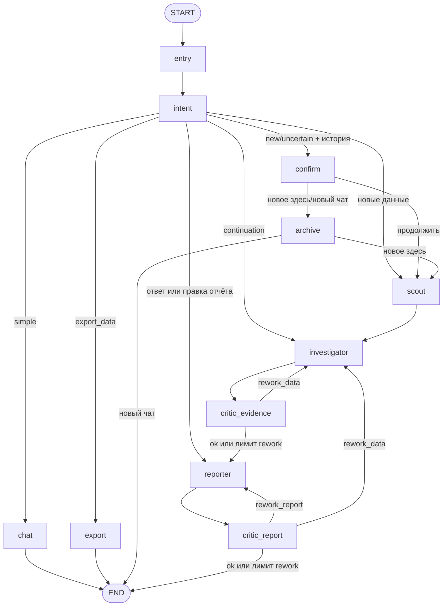
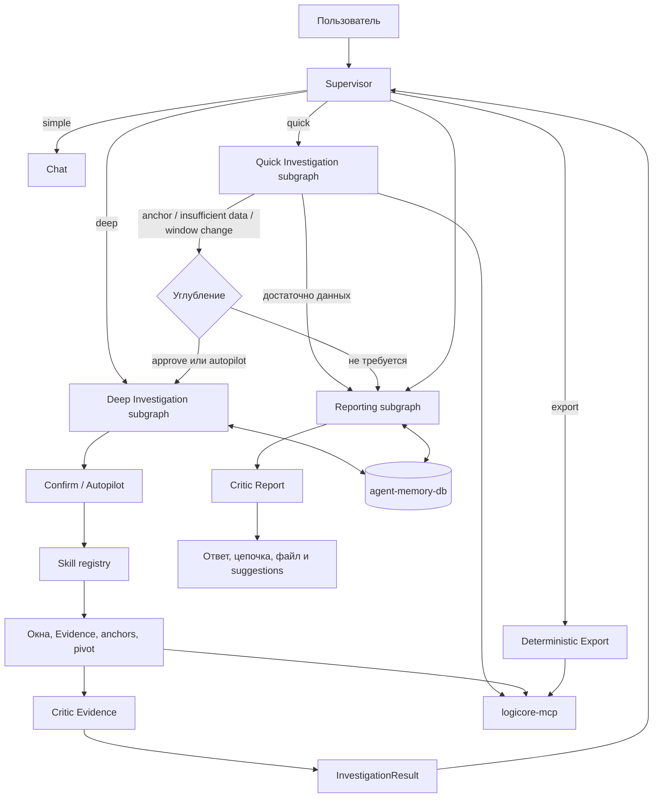

# LogiCore Agent

Многоагентная система для анализа событий LogiCore. LangGraph управляет диалогом,
LangChain выполняет приватные tool-циклы агентов, MCP-сервер читает данные через
Mars API, Aegra предоставляет API и checkpoints, Phoenix собирает трассировку.

Документы разделены по назначению:

- **этот README** — что работает сейчас и как запустить;
- [DEV.md](DEV.md) — текущая архитектура для разработчика;
- [INVESTIGATION_PLAN.md](INVESTIGATION_PLAN.md) — планируемые доработки;
- [AGENTS.md](AGENTS.md) — правила внесения изменений.

## Что работает сейчас

- Обычный чат без обращения к LogiCore.
- Структурированный intent: simple, complex, continuation, export и смена
  расследования.
- Поиск, подсчёт и агрегаты через 12 read-only MCP-инструментов.
- Приватные tool-циклы scout, investigator и reporter через `create_agent`.
- `Evidence` с фактическими аргументами, окном, статусом и результатом вызова.
- Структурированные ответы агентов и критиков с текстовым fallback.
- Continuation с сохранением `context.id`, окна, Evidence и findings.
- Подтверждение смены расследования через interrupt. Архив создаётся только
  после выбора `new/new_thread`.
- Детерминированный `extract_data`: серверная пагинация, таблица и Markdown-файл
  без генерации сотен строк через LLM.
- Одна карточка `progress`: этап и счётчик вызовов, обновление после каждого tool
  call, включая параллельные вызовы.
- Suggestion-кнопки после ответа и resume-кнопки для interrupt.
- Трассировка в Phoenix и regression-тесты графа/MCP.

Важно: quick/deep, skills, confirm/autopilot, долговременная память случаев и
аутентификация нескольких пользователей пока находятся **в плане**, а не в
текущей реализации.

## Сервисы

| Сервис | Порт | Назначение |
|---|---:|---|
| `aegra` | 2026 | LangGraph/Aegra API, workers и checkpoints |
| `agent-chat-ui` | 3000 | Веб-чат на Next.js |
| `logicore-mcp` | 9000, только Docker-сеть | 12 read-only MCP-инструментов |
| `anomaly-relay` | 2025 | Webhook LogiCore → тред и run |
| `postgres` | 5432 | Состояние Aegra, не отдельная память случаев |
| `redis` | 6379 | Очередь задач и SSE-брокер |
| `phoenix` | 6006 | OpenInference/OpenTelemetry-трассировка |

## Запуск

Требуется Docker с Compose v2:

```bash
cp .env.example .env
# Заполнить .env
docker compose up -d --build
```

Основные переменные:

- `LLM_BASE_URL`, `LLM_TOKEN`, `LLM_MODEL` — OpenAI-совместимый провайдер;
- `LOGIQ_URL`, `LOGIQ_USER`, `LOGIQ_PASSWORD`, `LOGIQ_TLS_VERIFY` — LogiCore;
- `LOGIQ_API_TOKEN` — авторизация MCP streamable-http;
- `POSTGRES_PASSWORD` — пароль Postgres Aegra;
- `RELAY_TOKEN`, `DEFAULT_CALLBACK_URL` — опциональные webhook/отчёты.

После запуска:

- чат: http://localhost:3000;
- API: http://localhost:2026;
- Phoenix: http://localhost:6006;
- webhook: `http://<хост>:2025/anomaly`.

Проверка:

```bash
docker compose ps
curl http://localhost:2026/health
```

Anonymous-режим подходит только для локальной разработки.

## Текущий граф



При `CRITIC_ENABLED=false` критики пропускаются. `export` не вызывает LLM и не
проходит критиков.

Публичный `messages` содержит только сообщения пользователя и финальные ответы.
Tool-циклы остаются в `scout_msgs`, `inv_msgs`, `rep_msgs`.

Подробности состояния и маршрутов — в [DEV.md](DEV.md).

## Целевой граф (план)

Эта схема показывает направление доработок, а не текущую реализацию:



Quick и deep используют общие Evidence и handoff, но имеют разные бюджеты,
модели и жизненный цикл. Полный контракт находится в
[INVESTIGATION_PLAN.md](INVESTIGATION_PLAN.md).

## Лимиты и таймауты

Пользовательского бюджета времени и вопросов о нём нет.

| Ограничение | Значение |
|---|---:|
| Tool calls скаута за один `ainvoke` | 10 |
| Tool calls инвестигейтора за один `ainvoke` | 30 |
| Tool calls репортёра за один `ainvoke` | 60 |
| Таймаут одного вложенного `create_agent.ainvoke` | 600 с |
| Таймаут узла `export` | 120 с |
| Возвраты на доработку за внешний run | 1 |
| Строк на страницу `extract_data` | 100 |
| Строк в `extract_data` по умолчанию | 1000 (`LOGIQ_EXTRACT_MAX_ROWS`) |
| Допустимый `max_rows` одного вызова | 1–5000 |
| MCP rate limit | 300 вызовов за скользящие 600 с |

`run_limit` сбрасывается при каждом новом запуске соответствующего агента:
новое сообщение, rework или retry structured response. Это не общий лимит чата.
Autopilot в будущем не будет отменять эти ограничения.

При исчерпании tool limit middleware завершает текущий tool-цикл, внешний граф
продолжает работу. Таймаут одного агента не ограничивает длительность всего run:
прямые вызовы intent, chat и критиков отдельным таймаутом сейчас не покрыты.

## Текущие ограничения и велосипеды

Не весь собственный код является велосипедом: Evidence, окна, anchors, pivot,
`extract_data`, `progress` и отчёты относятся к предметной логике. Но есть явные
места для исправления.

| Место | Проблема сейчас | Как исправлять |
|---|---|---|
| Structured response fallback | Ручной разбор function calls и текстовый fallback в `agents.py` частично дублирует runtime | Пересмотреть и упростить вокруг `create_agent`/`with_structured_output`, сохранив необходимую совместимость провайдера |
| Evidence для критика | Полные записи есть в state, но `evidence_block` усекает события и общий размер | Полный `EvidenceBundle` и `get_evidence(id)`, без скрытой потери данных |
| Работа с окном | `normalize_tool_result` жёстко подставляет окно из context | `base/focus/window_update`: явные окна агента уважаются, смена окна не означает новый случай |
| Будущие permissions | Нужны разрешения разных уровней | `HumanInTheLoopMiddleware` для write tools; `ActionRequest + interrupt` для окон, skills и quick → deep |
| Будущая память | Свой memory framework был бы лишним | `BaseStore`/`PostgresStore` в отдельной `agent-memory-db`; доменные таблицы только для метрик и связей |
| Будущие skills | Нельзя строить ещё один пакетный runtime | Небольшой registry + Pydantic-контракты + версии и stop rules |
| Суммаризация | Пока не реализована | Использовать `SummarizationMiddleware`, не писать собственную |
| Критик | Ошибка критика сейчас превращается в `ok` | Явный `critic_unavailable` и ограничение результата |

## План доработок по ценности

1. **Quick/deep и автономные окна** — правильная ежедневная работа.
2. **Полные Evidence и цепочка расследования** — проверяемость выводов.
3. **Confirm/autopilot и настройки из чата** — управляемая автономия.
4. **`incident_dating`** — первый самостоятельный deep-skill.
5. **Pivot и drilldown** — расширение расследования.
6. **Память между тредами** — использование прошлых случаев без устаревших ответов.
7. **Модели и метрики** — оптимизация стоимости и качества.

Этапы 1–4 образуют MVP. Полный план, контракты и приёмочные сценарии —
[INVESTIGATION_PLAN.md](INVESTIGATION_PLAN.md).

## Структура проекта

```text
├── agent/
│   ├── graph.py           # внешний StateGraph и маршруты
│   ├── agents.py          # runtime scout/investigator/reporter
│   ├── investigation.py   # текущие intent, окно, архив и подтверждение
│   ├── export.py          # детерминированная таблица и файл
│   ├── critics.py         # критики доказательств и отчёта
│   ├── progress.py        # статус, лимиты и suggestion-действия
│   ├── llm.py             # LLM и Pydantic-схемы ответов
│   ├── state.py           # внешнее и внутреннее состояние
│   ├── tools.py           # MCP tools, Evidence, отчёты
│   └── prompts/           # системные промпты
├── logicore-mcp/          # MCP-сервер и пагинация Mars API
├── anomaly-relay/         # webhook LogiCore
├── ui/                    # agent-chat-ui
├── tests/                 # regression-тесты графа и MCP
└── docker-compose.yml
```

## Обновление

```bash
git pull
docker compose up -d --build
```

После изменения кода агента для гарантированного обновления всех workers:

```bash
docker compose up -d --force-recreate aegra
```

После изменения только `.env` нужен `docker compose up -d`: обычный `restart`
не перечитывает `env_file`.
