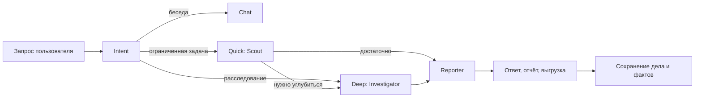
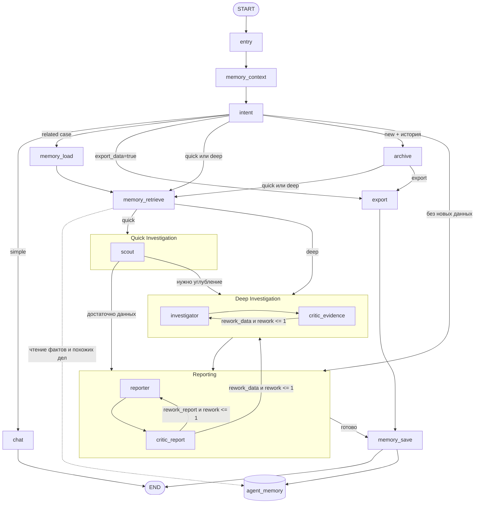
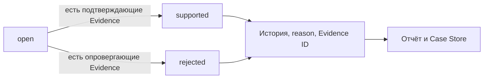
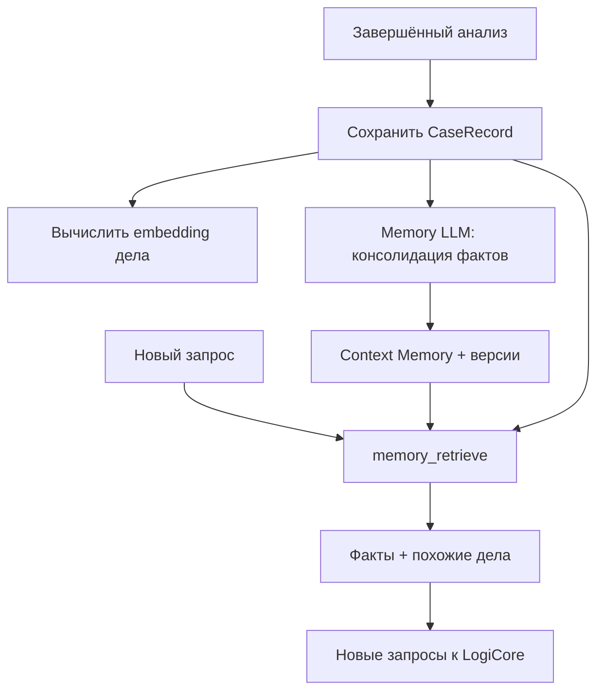

# LogiCore Agent: руководство по работе и устройству

Этот документ описывает **самого агента**: как он понимает запрос, выбирает режим,
собирает доказательства, проверяет гипотезы, формирует отчёт и использует память.
Aegra, PostgreSQL, Docker и UI рассматриваются только как среда исполнения — их
устройство здесь не разбирается.

## Оглавление

1. [Что агент делает](#1-что-агент-делает)
2. [Термины](#2-термины)
3. [Общая модель работы](#3-общая-модель-работы)
4. [Маршрут одного запроса](#4-маршрут-одного-запроса)
5. [Роли агентов](#5-роли-агентов)
6. [Основные сценарии](#6-основные-сценарии)
7. [Окна и investigation skills](#7-окна-и-investigation-skills)
8. [Evidence, findings и гипотезы](#8-evidence-findings-и-гипотезы)
9. [Память агента](#9-память-агента)
10. [Модели данных](#10-модели-данных)
11. [Инструменты](#11-инструменты)
12. [Отчёты и выгрузка](#12-отчёты-и-выгрузка)
13. [LLM и embeddings](#13-llm-и-embeddings)
14. [Лимиты и поведение при сбоях](#14-лимиты-и-поведение-при-сбоях)
15. [Что видит пользователь](#15-что-видит-пользователь)
16. [Текущие ограничения](#16-текущие-ограничения)
17. [Карта кода и проверки](#17-карта-кода-и-проверки)

---

## 1. Что агент делает

Агент расследует события LogiCore как аналитик, а не просто отвечает на вопросы
по логам одним LLM-запросом. Он умеет:

- отличить обычный разговор от задачи на анализ;
- быстро получить ограниченный ответ или начать глубокое расследование;
- самостоятельно расширять и сужать временное окно;
- вызывать read-only инструменты LogiCore;
- сохранять каждый фактический результат как Evidence;
- выдвигать, подтверждать и опровергать гипотезы;
- проверять собственные выводы через критиков;
- строить отчёт с фактической цепочкой работы;
- выгружать события таблицей и Markdown-файлом;
- продолжать дело в другом треде;
- находить знания окружения и похожие прошлые дела.

Агент **не дообучает LLM** и не изменяет её веса. «Самообучение» здесь означает
только накопление структурированных дел, фактов и повторно используемых skills.

Главное правило: **память и текст LLM не являются доказательством**. Доказательством
служит только конкретный результат инструмента с его аргументами, окном и статусом.

## 2. Термины

| Термин | Что означает в этой системе |
|---|---|
| **Run** | Один проход графа от нового сообщения до результата или остановки |
| **Thread** | Диалог со своей историей и рабочим состоянием |
| **Supervisor** | Внешний граф, который выбирает следующий этап |
| **Intent** | Структурированное решение о типе запроса и маршруте |
| **Quick** | Ограниченная проверка через Scout без глубокого расследования |
| **Deep** | Полное расследование через Investigator и Critic Evidence |
| **Investigation / case** | Текущая задача со своими окнами, Evidence и выводами |
| `context.id` | Идентификатор текущего дела; сохраняется при follow-up и смене окна |
| **Skill** | Версионируемый playbook для определённого типа расследования |
| **Anchor** | Типизированная сущность: IP, account, host, hash, process, event или custom |
| **Evidence** | Запись фактического вызова инструмента и его результата |
| **Finding** | Короткая аналитическая запись со ссылками на Evidence |
| **Claim** | Утверждение в ответе, которое должно ссылаться на Evidence ID |
| **Hypothesis** | Объяснение со статусом `open`, `supported` или `rejected` |
| **Coverage** | Оценка полноты быстрой проверки: complete, partial, empty или error |
| **Rework** | Повторная работа investigator или reporter по требованию критика |
| `NOT_CHECKED` | Явный список того, что не удалось проверить, и причин |
| **Case Store** | Долговременное хранилище полных карточек завершённых дел |
| **Context Memory** | Атомарные факты об окружении с источником и сроком актуальности |
| **Continuation** | Осознанное продолжение конкретного прошлого дела |
| **Similar case** | Похожее прошлое дело, используемое как подсказка, но не как continuation |
| **Structured output** | Ответ LLM по Pydantic-схеме, а не свободный текст с ручным parser |
| **Embedding** | Векторное представление текста для семантического поиска |

## 3. Общая модель работы



Агент состоит из трёх разных субграфов:

- **Quick Investigation** — только Scout;
- **Deep Investigation** — Investigator и Critic Evidence;
- **Reporting** — Reporter и Critic Report.

Scout не находится внутри Deep Investigator. Это отдельные режимы с разными
промптами, моделями по умолчанию и лимитами. Supervisor связывает их между собой.

## 4. Маршрут одного запроса



Назначение ключевых узлов:

| Узел | Что делает |
|---|---|
| `entry` | Очищает run-scoped каналы, сохраняя текущее дело |
| `memory_context` | Даёт Intent компактных кандидатов на continuation |
| `intent` | Выбирает режим, окно, skill и continuation/new |
| `memory_load` | Восстанавливает конкретное дело и требует контрольный запрос |
| `memory_retrieve` | Ищет факты и похожие дела перед quick/deep |
| `archive` | Сохраняет прежний отчёт перед явной сменой темы |
| `quick` | Выполняет Scout |
| `deep` | Выполняет Investigator и Critic Evidence |
| `reporting` | Формирует ответ и проверяет его через Critic Report |
| `export` | Механически выгружает события без LLM |
| `memory_save` | Сохраняет дело и консолидирует Context Memory |

При `CRITIC_ENABLED=false` критики пропускаются. Чистый export не вызывает
LLM-консолидацию фактов, но дело всё равно проходит `memory_save`.

## 5. Роли агентов

| Роль | Ответственность | Инструменты | Structured response |
|---|---|---|---|
| **Intent** | Понимает задачу и маршрутизирует её | Нет | `IntentDecision` |
| **Scout** | Делает 1–2 ограниченные проверки и решает, нужен ли deep | MCP, findings, memory search | `ScoutResult` |
| **Investigator** | Ищет причины, меняет окна, проверяет гипотезы и pivot | MCP, Evidence, окна, гипотезы, memory search | `InvestigationResult` |
| **Reporter** | Пишет ответ, отчёт и выбирает Evidence | Findings, Evidence, report/export tools | `ReporterResult` |
| **Critic Evidence** | Проверяет достаточность доказательств | Нет | `CriticEvidence` |
| **Critic Report** | Проверяет ответ и его соответствие Evidence | Нет | `CriticReport` |
| **Memory LLM** | Извлекает и согласует долговременные факты | Нет | `ContextMemoryConsolidation` |

Критики не вызывают MCP и не расходуют tool limits агентов. Их отказ не превращается
в молчаливое подтверждение качества: фиксируется `critic_unavailable`.

## 6. Основные сценарии

### 6.1. Обычный разговор

«Привет», «что ты умеешь» и общие вопросы идут в chat. LogiCore и долговременная
память расследований не вызываются.

### 6.2. Quick

Подходит для количества событий, обзора периода, топа значений, карточки события
или одной проверки. Scout возвращает:

- `note` и `answer_candidate`;
- signals и Evidence ID;
- anchors;
- coverage;
- `escalation.needed/reason/suggested_skill`.

Если данных достаточно, Reporter сразу формирует ответ. Иначе начинается Deep.

### 6.3. Deep

Нужен для причин, первого появления, нескольких гипотез, pivot, смены окна и
продолжения сложного расследования. Investigator может вызывать инструменты
многократно, но обязан завершить работу структурированным результатом.

### 6.4. Quick → Deep

Scout нашёл зацепку, данные неполны, нужна причина, другое окно или pivot.
Текущие `context.id`, окно и Evidence сохраняются. Это не новое расследование.

### 6.5. Deep → quick → deep

Точечный follow-up может быть quick. Если он снова требует глубины, граф возвращается
к Investigator. История режимов сохраняется в `depth_history`.

### 6.6. Новая тема

При явном `new_investigation=new` прежний отчёт архивируется, создаются новый
`context.id` и окно. Evidence, findings, гипотезы, anchors и skill runs очищаются.
При `uncertain` продолжается текущее дело — уточняющего interrupt нет.

### 6.7. Продолжение прошлого дела

В новом треде Intent может выбрать `related_investigation_id` из memory candidates.
Загружаются контекст, Evidence, findings, гипотезы, окна и отчёт. Перед использованием
старого вывода обязателен новый контрольный запрос к LogiCore.

### 6.8. Отчёт и выгрузка событий

«Отчёт», «отчёт расследования» и «аналитический отчёт» идут в Reporting: Reporter
создаёт или правит файл с выводами, Evidence и цепочкой, даже если файла ещё не было.
Полная таблица или файл с **сырыми событиями** идут через export без нового анализа.
Это разные маршруты: аналитический отчёт никогда не заменяется выгрузкой событий.

## 7. Окна и investigation skills

У дела есть три связанных представления времени:

- **активное окно** — используется по умолчанию;
- **base_window** — исходная область расследования;
- **focus_window** — временное сужение внутри base.

`update_window` работает так:

| Action | Эффект |
|---|---|
| `focus` | Устанавливает временное окно, base сохраняется |
| `expand` | Расширяет base до объединения старого и запрошенного |
| `replace` | Полностью заменяет активное и base-окна |
| `preserve` | Ничего не меняет |

Каждое изменение попадает в `window_history` и progress. Явно переданные
`time_from/time_to` обычного MCP-вызова контекст не перезаписывает.

### Доступные skills

| Skill | Когда применяется | Основные ограничения |
|---|---|---|
| `incident_dating` v1 | Найти первое наблюдаемое событие | До 8 изменений окна; до 2 окон без новой информации |
| `event_drilldown` v1 | Разобрать одно событие по `uuid + timestamp` | Не меняет окно и не делает pivot |
| `entity_pivot` v1 | Проверить связанные сущности | Глубина 2, до 4 новых anchors и 4 смены окна |

`incident_dating` движется адаптивно: 1 час → 6 часов → 24 часа → 3/7/30 дней,
затем сужает вилку. Результат называется **первым наблюдаемым событием**, а не
гарантированным абсолютным началом инцидента.

Anchors канонизируются как `type:value` в нижнем регистре. Повторные ветки,
anchors без Evidence и превышение лимитов приводят к `partial` и `NOT_CHECKED`.

## 8. Evidence, findings и гипотезы

### 8.1. Что такое Evidence

Каждый MCP-результат нормализуется в JSON и превращается в `EvidenceRecord`.
Это исключает `[object Object]` и позволяет проверить не только текст, но и вызов.

Агент получает компактный обзор, полную запись читает через `get_evidence(id)`.
Критик получает полный Evidence Bundle по всем ID из claims без скрытого усечения.

### 8.2. Finding и claim

`log_finding` сохраняет аналитическую заметку: claim, Evidence ID и следующее действие.
Finding — это ещё не доказанный факт, а запись хода расследования. Claim в итоговом
ответе должен ссылаться на существующие Evidence ID.

### 8.3. Журнал гипотез



`open` разрешён без Evidence. Для `supported/rejected` хотя бы один валидный ID
обязателен. При пересмотре передаётся тот же `hypothesis_id`, поэтому запись
обновляется без дублирования. История переходов сохраняется.

Гипотезы попадают в `investigation_chain`, отдельный раздел Markdown-отчёта и Case
Store. Открытая гипотеза не становится долговременным фактом Context Memory.

### 8.4. Проверка критиками

Сначала выполняются детерминированные проверки:

- нет ли несуществующих Evidence ID;
- не неполное ли окно;
- использованы ли partial/error без limitations;
- подтверждены ли терминальные статусы гипотез.

Затем LLM возвращает verdict, feedback и `issues`. Каждый issue содержит claim,
Evidence ID, причину и `suggested_action=rework_report/rework_data`.

## 9. Память агента

У агента нет одной универсальной «живой памяти». Есть четыре разных механизма.

### 9.1. Рабочее состояние треда

Содержит текущие сообщения, окна, Evidence, findings, гипотезы, skills и отчёты.
Этого достаточно для continuation внутри одного треда.

### 9.2. Case Store

После reporting/export дело сохраняется как `CaseRecord` в `agent_memory.investigations`.
Хранится полный снимок плюс metadata для поиска: task, summary, signature, entities,
work mode, timestamps и embedding.

Case Store используется для:

- явного continuation;
- аудита прошлой работы;
- поиска похожих дел.

### 9.3. Context Memory

После аналитического run отдельный structured LLM-шаг предлагает до восьми операций
`insert/update/supersede/ignore` над атомарными фактами.

Правила:

- явный факт пользователя можно сохранить без Evidence;
- investigation-факт `confirmed` требует валидные Evidence;
- разовое наблюдение сохраняется как `observed`, а не как общая закономерность;
- `observed` по умолчанию получает TTL 24 часа;
- `update` объединяет provenance;
- `supersede` создаёт новую версию и закрывает старую через `valid_to/superseded_by`;
- exact duplicate и similarity ≥ 0.90 превращают insert в update;
- гипотезы, сырые события, счётчики и временный операционный статус не сохраняются.

Каждое предложение попадает в `memory_operations`: исходное и фактическое действие,
statement, target/fact ID, статус `saved/rejected/ignored`, причина и ошибка. Журнал
сохраняется в Case Store, добавляется в отчёт и `manifest.json`. Пустая консолидация
и `memory_error` отображаются явно; сбой памяти не отменяет расследование.

### 9.4. Похожие дела

`search_similar_cases` ищет по task, signature и entities через pgvector. Возвращаются
только компактные карточки, без полного state.

Похожее дело — это подсказка для новой проверки. Оно не меняет `context.id`, не
загружается как continuation и не даёт текущие Evidence.

### 9.5. Поток записи и чтения



Если embeddings недоступны, дело всё равно сохраняется, но не участвует в vector
search. Старые дела без embedding появятся в поиске похожих после следующего save.
Ошибка памяти не останавливает диалог.

## 10. Модели данных

### 10.1. `IntentDecision`

| Поле | Назначение |
|---|---|
| `intent` | simple, complex или continuation |
| `work_mode` | quick или deep |
| `needs_new_data` | Нужны ли новые запросы к LogiCore |
| `new_investigation` | continue, new или uncertain |
| `window_requested` | Явно ли задан другой период |
| `window` | last_minutes или точные time_from/time_to |
| `skill_id` | Выбранный skill или null |
| `related_investigation_id` | Дело для явного continuation |
| `confidence` | Уверенность маршрутизации 0–1 |
| `escalation_reason` | Причина deep |
| `edit_existing_report`, `export_data` | Специальные маршруты |

### 10.2. `EvidenceRecord`

| Поле | Назначение |
|---|---|
| `id`, `step_id` | ID записи, обычно tool call ID |
| `investigation_id` | Дело, к которому относится Evidence |
| `tool` | Фактически вызванный инструмент |
| `arguments` | Реальные аргументы вызова |
| `window` | Фактическое окно и его источник |
| `status` | ok, partial или error |
| `complete` | Полный ли результат |
| `result_ref` | Стабильная ссылка `evidence://case/id` |
| `created_at` | Время записи |
| `result` | Полный нормализованный результат |
| `error` | Ошибка или null |

### 10.3. `FindingRecord`

Содержит `timestamp`, `claim`, `evidence_ids` и `next_action`.

### 10.4. `Hypothesis`

| Поле | Назначение |
|---|---|
| `id` | Стабильный ID для пересмотра |
| `text` | Формулировка объяснения |
| `status` | open, supported или rejected |
| `evidence_ids` | Основание текущего статуса |
| `reason` | Человекочитаемая причина перехода |
| `created_at`, `updated_at` | Время создания и последнего изменения |
| `history` | Все переходы со временем, reason и Evidence ID |

### 10.5. `ScoutResult`

`note`, `answer_candidate`, `signals`, `evidence_ids`, `anchors`, `coverage` и
`escalation`. Coverage содержит `complete/partial/empty/error` и details.

### 10.6. `InvestigationResult`

- `status=done/partial/failed`;
- `summary`;
- `claims` с Evidence ID;
- `limitations` и `not_checked`;
- `recommended_export_query` или null;
- необязательный `skill_run`.

### 10.7. `ReporterResult`

`answer`, `claims`, `limitations`, `not_checked` и `recommended_export_query`.

### 10.8. `CriticIssue`

`claim`, `evidence_ids`, `reason` и `suggested_action`.

### 10.9. `CaseRecord`

Полный снимок дела:

- `investigation_id`, `user_id`, `thread_id`;
- `task`, `summary`, `signature`, `entities`, `updated_at`;
- `context`, `work_mode`, `depth_history`;
- `evidence`, `findings`, `hypotheses`;
- `skill_runs`, `anchors`, `visited_anchors`;
- `inv_summary`, `inv_result`, `last_report`, `memory_operations`, `chain`.

### 10.10. `ContextFact`

`statement`, `entities`, `category`, `status`, `source_kind`, `source_case_ids`,
`evidence_ids`, `valid_from`, `valid_to`, `superseded_by`, `scope`, `created_at` и
`updated_at`. Embedding хранится рядом в таблице, а не внутри Pydantic-объекта.

### 10.11. `SkillRunResult`

`skill_id`, `version`, `status`, `summary`, `window_updates`, `evidence_ids`,
`anchors`, `visited_anchors`, `depth`, `model`, `duration_ms` и `not_checked`.

## 11. Инструменты

### 11.1. MCP LogiCore

Все инструменты read-only:

| Инструмент | Назначение |
|---|---|
| `search_events` | Поиск событий по фильтру и окну |
| `extract_data` | Полная выгрузка с внутренней пагинацией |
| `count_events` | Количество и интенсивность событий |
| `timeline` | Распределение по времени |
| `top_values`, `top_values_batch` | Топы одного или нескольких полей |
| `get_event` | Карточка события по uuid + timestamp |
| `field_fill_rates` | Заполненность полей |
| `duplicates` | Поиск дубликатов |
| `field_lookup`, `enum_lookup` | Справочники полей и значений |
| `server_time` | Текущее серверное время |

Windowed tools определяются по JSON Schema через `time_from/time_to`, а не по
hardcoded списку имён.

### 11.2. Внутренние инструменты агента

| Инструмент | Назначение |
|---|---|
| `get_evidence` | Прочитать полную Evidence без повторного MCP-запроса |
| `log_finding`, `list_findings`, `get_finding` | Вести журнал находок |
| `update_window` | Изменить окно текущего дела |
| `update_hypothesis` | Создать или пересмотреть гипотезу |
| `search_context_memory` | Найти факты по новой сущности или симптому |
| `search_similar_cases` | Найти компактные карточки похожих дел |
| `save_report` | Сохранить Markdown-отчёт |
| `send_report` | Доставить отчёт на callback |

## 12. Отчёты и выгрузка

Отчёт состоит из двух частей:

1. Текст Reporter на основании Evidence.
2. Детерминированная цепочка из state: задача, действия, окна, гипотезы, находки,
   limitations и `NOT_CHECKED`.

LLM не создаёт эту хронологию и не может добавить в неё несуществующие шаги.
`save_report` создаёт именно аналитический отчёт; `extract_data` предназначен только
для сырых событий и не заменяет его.

Для проверки результата Reporter прикрепляет Markdown и ZIP-пакет:

```text
investigation.zip
├── report.md       # отчёт и детерминированная цепочка
├── queries.md      # фактические IQL/JSON-запросы и номера Evidence
├── evidence.jsonl  # полная запись каждого вызова и результата
├── events.csv      # события со ссылками на Evidence
└── manifest.json   # case ID, индекс Evidence, неполные данные и SHA-256 файлов
```

IQL приходит непосредственно из MCP и совпадает с выполненным запросом. Для вызовов
без IQL показываются фактические JSON-аргументы. В «Ход работы» запрос связан с
номером записи в `evidence.jsonl`. Пакет создаётся детерминированно из state.

Export:

1. Берёт `recommended_export_query` из Reporter/Investigator.
2. Если его нет, использует прежний фильтр Evidence.
3. Берёт текущие границы окна.
4. Вызывает `extract_data` напрямую, без LLM.
5. Формирует Evidence, Markdown-таблицу и файл.

Внутри MCP выгрузка идёт по 100 событий на страницу. Повтор страницы останавливает
цикл с `complete=false`. Достигнутый `max_rows` даёт `complete=false` и `next_page`.

### 12.1. ArtifactStore

`agent/artifact_store.py` сохраняет файлы в SeaweedFS по S3 API. Ключ имеет вид
`investigations/<case-id>/<run-id>/<filename>`. В `state.artifacts` находятся только
storage, key, filename, content type и размер; base64 остаётся лишь в inline fallback
локального режима или при сбое S3 для файлов до 256 КиБ.

UI и callback получают подписанные HTTPS-ссылки. TTL по умолчанию 3600 секунд. При
повторном открытии отчёта или вызове `investigation_result` подпись создаётся заново,
поэтому в state не сохраняется протухающий URL. Callback дополнительно получает
object keys и метаданные файлов.

### 12.2. Внешний MCP агента

`agent-mcp/app.py` — адаптер над Aegra runs API, а не второй движок расследований:

| Инструмент | Результат |
|---|---|
| `investigation_start` | Немедленный `investigation_id` и `run_id` |
| `investigation_status` | Фактический run status, этап, прогресс и ошибки |
| `investigation_result` | Отчёт, аудит памяти и свежие S3-ссылки |
| `investigation_evidence` | Все Evidence или одна полная запись |
| `investigation_cancel` | Отмена активного run с сохранением state |

Все вызовы асинхронные. Structured JSON не содержит base64. Доступ ограничен тредами
`inv-*`, созданными через MCP; произвольные UI-треды прочитать нельзя. Сервис защищён
статическим Bearer `AGENT_MCP_TOKEN`, OIDC не добавляется. A2A может быть позже
реализован поверх этого же адаптера; ACP не требуется.

## 13. LLM и embeddings

Модели назначаются по ролям через env:

| Настройка | Роль | Пустое значение |
|---|---|---|
| `LLM_MODEL` | Базовая модель | Обязательная база |
| `LLM_MODEL_INTENT` | Intent | Используется `LLM_MODEL` |
| `LLM_MODEL_SCOUT` | Scout | Используется `LLM_MODEL` |
| `LLM_MODEL_INVESTIGATOR` | Investigator | Используется `LLM_MODEL` |
| `LLM_MODEL_REPORTER` | Reporter | Используется `LLM_MODEL` |
| `LLM_MODEL_CRITIC` | Оба критика | Используется `LLM_MODEL` |
| `LLM_MODEL_MEMORY` | Консолидация Context Memory | Используется `LLM_MODEL` |

В `agent/config.py` базовым значением является `qwen3.7-flash`, но фактическая
модель развёртывания задаётся через `.env`.

Для Context Memory и похожих дел по умолчанию используется `bge-m3` с размерностью
1024. `AGENT_MEMORY_EMBEDDING_BASE_URL/TOKEN` позволяют задать отдельный
OpenAI-совместимый endpoint; иначе используются `LLM_BASE_URL/TOKEN`.

Structured output строится через function calling с fallback на JSON mode. Последний
резерв для Intent — консервативная deep-проверка без keyword-правил. Для агентов
остаётся текстовый fallback в Pydantic-схему с явной limitation.

## 14. Лимиты и поведение при сбоях

### 14.1. Основные лимиты

| Ограничение | Default и область | Что происходит |
|---|---|---|
| Scout tool calls | 10 на `create_agent.ainvoke` | Tool-цикл завершается |
| Investigator tool calls | 30 на `create_agent.ainvoke` | Tool-цикл завершается |
| Reporter tool calls | 60 на `create_agent.ainvoke` | Tool-цикл завершается |
| `MAX_REWORK` | 1 на внешний run | Дальше возвращается текущий результат |
| Agent timeout | 600 с на `create_agent.ainvoke` | Схемный результат с limitation |
| Export timeout | 120 с | Evidence error и ответ об ошибке |
| Summarization | 6000 tokens / 20 messages | История сокращается middleware |
| Critic context | 2000 message / 8000 dialog chars | Вход ограничивается |
| Report injection | 8000 chars | Длинный отчёт помечается обрезанным |
| Recent cases | 3 | Только кандидаты для continuation |
| Retrieved facts | 5 | Top-k Context Memory |
| Similar cases | 3 | Top-k похожих дел |
| Consolidation candidates | 10 | Существующие факты для согласования |
| Memory operations | 8 на run | Ограничение схемы ответа |
| Memory similarity | 0.10 | Минимальная cosine similarity |
| Memory dedup | 0.90 | Insert становится update |
| Observed TTL | 24 часа | Наблюдение перестаёт извлекаться |

Tool limit принадлежит одному `ainvoke` и сбрасывается на новый вызов: новое
сообщение, rework или retry structured response. Таймер его не сбрасывает.

### 14.2. Что не является общим дедлайном

`AGENT_TIMEOUT_SECONDS` не ограничивает весь чат. Прямые вызовы Intent, chat и
критиков отдельным agent timeout не покрыты, поэтому полный run может быть длиннее
600 секунд. Пользовательского бюджета времени нет.

### 14.3. Деградация

- Tool error или partial фиксируется в Evidence и должен попасть в limitations.
- `NOT_CHECKED` явно перечисляет непроверенные ветки.
- Сбой критика даёт `critic_unavailable`, но не останавливает run.
- Сбой памяти оставляет работу в state треда и заполняет `memory_error`.
- Сбой embeddings не мешает сохранить дело, но исключает его из vector search.
- Ошибка consolidation после сохранения дела не удаляет само дело.
- Отсутствие structured response превращается в явную limitation, а не скрытый parser.

## 15. Что видит пользователь

В публичном `messages` находятся только сообщения пользователя и финальные ответы.
Tool calls и внутренние рассуждения остаются в `scout_msgs`, `inv_msgs`, `rep_msgs`.

Отдельный `progress` показывает:

- текущий этап;
- переход quick/deep;
- значимую смену окна;
- проверку критиком;
- число вызовов и лимит текущего агента;
- завершение или ограничение.

Progress не передаётся LLM и не создаёт служебные сообщения в истории. После ответа
`suggestions` предлагает обычные follow-up действия: показать таблицу, сохранить
отчёт или продолжить расследование. Подтверждений, approval-interrupts и
slash-команд нет.

## 16. Текущие ограничения

- **Anonymous-режим:** пользователи не изолированы; OIDC/multiuser намеренно не
  реализуется.
- **Нет самообучения модели:** накапливаются дела, факты и skills, но веса LLM не
  изменяются.
- **Нет автоматического сравнения skills:** версии меняются вручную через registry.
- **Нет internet-enrichment:** агент работает с LogiCore и собственной памятью.
- **Стоимость памяти:** аналитический run добавляет один structured LLM-вызов для
  consolidation и embeddings для поиска.
- **Старые дела:** без embedding не участвуют в поиске похожих до следующего save.
- **Наблюдения не факты:** `observed` имеет ограниченный TTL и требует перепроверки.
- **Fallback:** текстовый structured fallback остаётся явной деградацией с limitation.
- **Нет общего дедлайна:** отдельные agent timeout не покрывает весь run.

## 17. Карта кода и проверки

### Основные модули

| Файл | Ответственность |
|---|---|
| `agent/graph.py` | Supervisor и маршруты |
| `agent/quick_graph.py` | Quick Investigation |
| `agent/investigation_graph.py` | Deep Investigation и Critic Evidence |
| `agent/reporting_graph.py` | Reporting и Critic Report |
| `agent/agents.py` | `create_agent`, модели, суммаризация, structured response |
| `agent/investigation.py` | Intent, continuation, окна и архивация |
| `agent/contracts.py` | Evidence, Finding, Coverage, CriticIssue, Hypothesis |
| `agent/llm.py` | LLM и Pydantic-контракты ответов |
| `agent/tools.py` | MCP и внутренние инструменты |
| `agent/evidence.py` | Evidence Bundle и детерминированная цепочка |
| `agent/memory.py` | Memory-узлы, consolidation и continuation |
| `agent/memory_models.py` | CaseRecord и ContextFact |
| `agent/memory_store.py` | Предметная схема и pgvector-поиск |
| `agent/artifact_store.py` | S3, object keys и подписанные URL |
| `agent-mcp/app.py` | Асинхронный MCP-адаптер расследований |
| `agent/skills/` | Версионируемые playbooks |

### Проверка

```bash
uv run --with "langchain==1.3.10" --with "langgraph==1.2.16" \
  --with "langchain-openai" --with "pydantic-settings" \
  --with "httpx" --with "tenacity" --with "pytest" --with "loguru" \
  --with "psycopg" --with "mcp[cli]>=2,<3" pytest -q tests
```

Тесты используют fake LLM/MCP и настоящий граф. Покрыты quick/deep, окна, Evidence,
гипотезы, критики, continuation, Context Memory, похожие дела, export, лимиты,
деградации и structured response. Живые сценарии дополнительно проверяются через
реальный API на новых тредах.
