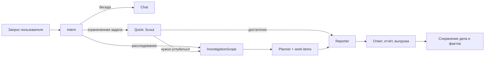
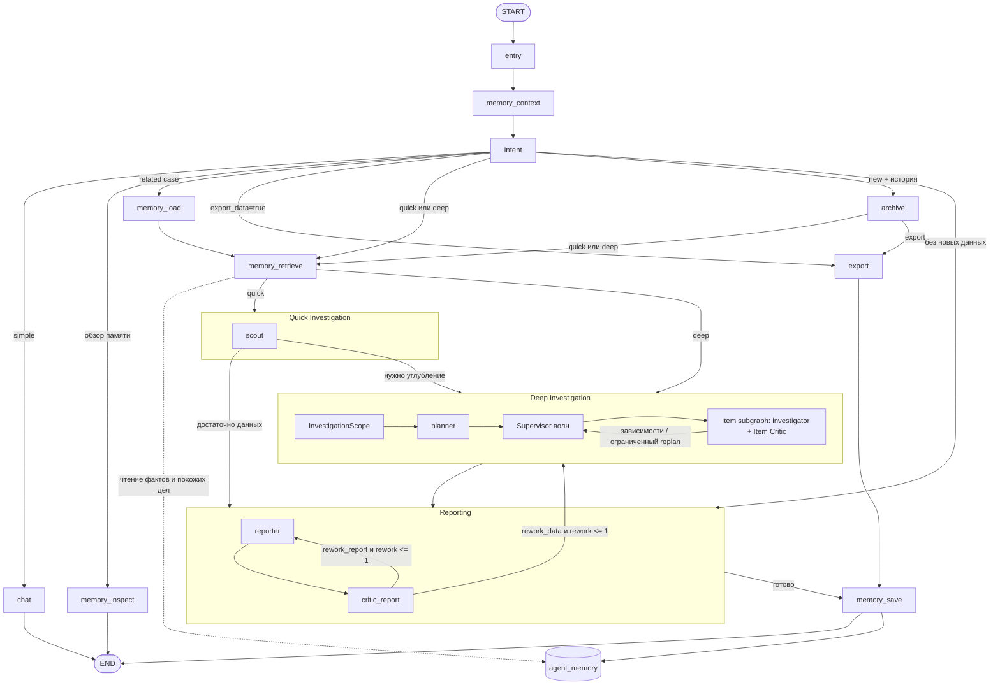
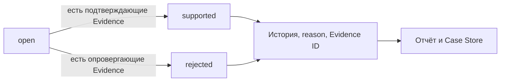
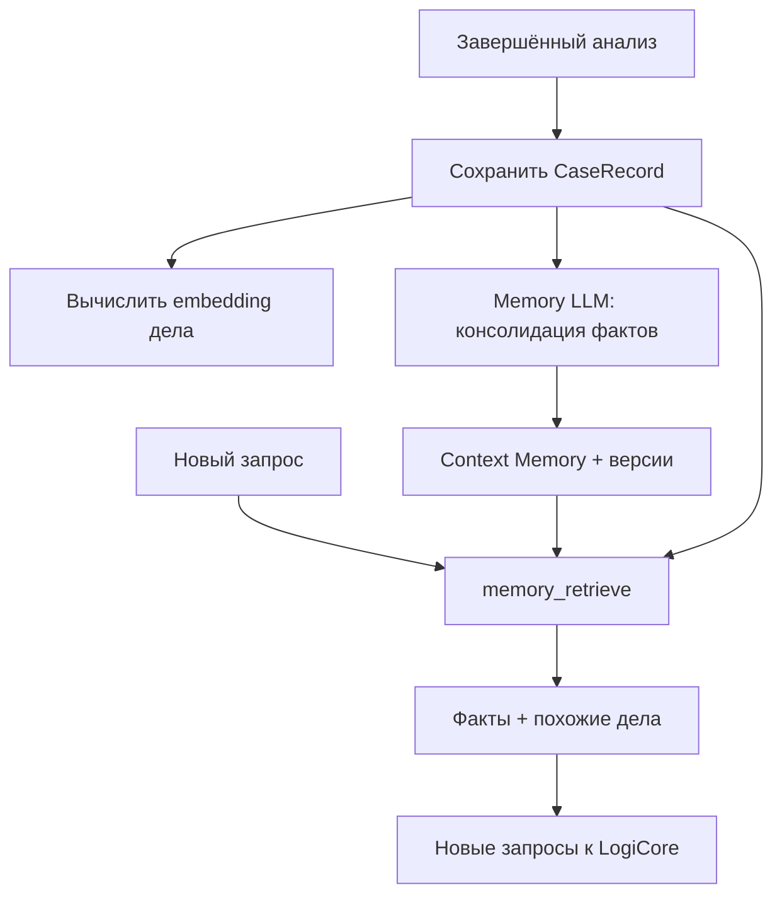

# LogiCore Agent: руководство по работе и устройству

Этот документ описывает **самого агента**: как он понимает запрос, выбирает режим,
собирает доказательства, проверяет гипотезы, формирует отчёт и использует память.
Aegra, PostgreSQL, Docker и UI рассматриваются только как среда исполнения — их
устройство здесь не разбирается. Текущая интеграция Phoenix — [OBSERVABILITY.md](OBSERVABILITY.md),
только будущие изменения — [ROADMAP.md](ROADMAP.md).

## Оглавление

1. [Что агент делает](#1-что-агент-делает)
2. [Термины](#2-термины)
3. [Общая модель работы](#3-общая-модель-работы)
4. [Маршрут одного запроса](#4-маршрут-одного-запроса)
5. [Роли агентов](#5-роли-агентов)
6. [Основные сценарии](#6-основные-сценарии)
7. [Окна и investigation skills](#7-окна-и-investigation-skills)
8. [Evidence, findings и гипотезы](#8-evidence-findings-и-гипотезы)
9. [Память агента](#9-память-агента)
10. [Модели данных](#10-модели-данных)
11. [Инструменты](#11-инструменты)
12. [Отчёты и выгрузка](#12-отчёты-и-выгрузка)
13. [LLM и embeddings](#13-llm-и-embeddings)
14. [Лимиты и поведение при сбоях](#14-лимиты-и-поведение-при-сбоях)
15. [Что видит пользователь](#15-что-видит-пользователь)
16. [Текущие ограничения](#16-текущие-ограничения)
17. [Карта кода и проверки](#17-карта-кода-и-проверки)

---

## 1. Что агент делает

Агент расследует события LogiCore как аналитик, а не просто отвечает на вопросы
по логам одним LLM-запросом. Он умеет:

- отличить обычный разговор от задачи на анализ;
- быстро получить ограниченный ответ или начать глубокое расследование;
- самостоятельно расширять и сужать временное окно;
- вызывать read-only инструменты LogiCore;
- сохранять каждый фактический результат как Evidence;
- выдвигать, подтверждать и опровергать гипотезы;
- проверять собственные выводы через критиков;
- строить отчёт с фактической цепочкой работы;
- выгружать события таблицей и Markdown-файлом;
- продолжать дело в другом треде;
- находить знания окружения и похожие прошлые дела.

Агент **не дообучает LLM** и не изменяет её веса. «Самообучение» здесь означает
только накопление структурированных дел, фактов и повторно используемых skills.

Главное правило: **память и текст LLM не являются доказательством**. Доказательством
служит только конкретный результат инструмента с его аргументами, окном и статусом.

## 2. Термины

| Термин | Что означает в этой системе |
|---|---|
| **Run** | Один проход графа от нового сообщения до результата или остановки |
| **Thread** | Диалог со своей историей и рабочим состоянием |
| **Supervisor** | Внешний граф, который выбирает следующий этап |
| **Intent** | Структурированное решение о типе запроса и маршруте |
| **Quick** | Ограниченная проверка через Scout без глубокого расследования |
| **Deep** | Расследование через Scope, Planner, Investigator и Critic Evidence |
| **InvestigationScope** | Границы этапа: discovery/targeted/alert, required и optional |
| **Acceptance** | Ограниченный критерий завершения work item, а не список всех проверок |
| **Investigation / case** | Текущая задача со своими окнами, Evidence и выводами |
| `context.id` | Идентификатор текущего дела; сохраняется при follow-up и смене окна |
| **Skill** | Версионируемый playbook для определённого типа расследования |
| **Anchor** | Типизированная сущность: IP, account, host, hash, process, event или custom |
| **Evidence** | Запись фактического вызова инструмента и его результата |
| **Finding** | Короткая аналитическая запись со ссылками на Evidence |
| **Claim** | Утверждение в ответе, которое должно ссылаться на Evidence ID |
| **Hypothesis** | Объяснение со статусом `open`, `supported` или `rejected` |
| **Coverage** | Оценка полноты быстрой проверки: complete, partial, empty или error |
| **Rework** | Повторная работа investigator или reporter по требованию критика |
| `NOT_CHECKED` | Явный список того, что не удалось проверить, и причин |
| **Case Store** | Долговременное хранилище полных карточек завершённых дел |
| **Context Memory** | Атомарные факты об окружении с источником и сроком актуальности |
| **Continuation** | Осознанное продолжение конкретного прошлого дела |
| **Similar case** | Похожее прошлое дело, используемое как подсказка, но не как continuation |
| **Structured output** | Ответ LLM по Pydantic-схеме, а не свободный текст с ручным parser |
| **Embedding** | Векторное представление текста для семантического поиска |

## 3. Общая модель работы



Агент состоит из трёх разных субграфов:

- **Quick Investigation** — только Scout;
- **Deep Investigation** — Scope, Planner, item-subgraphs Investigator + Item Critic и
  supervisor волн;
- **Reporting** — Reporter и Critic Report.

Scout не находится внутри Deep Investigator. Это отдельные режимы с разными
промптами, моделями по умолчанию и лимитами. Supervisor связывает их между собой.

## 4. Маршрут одного запроса



Назначение ключевых узлов:

| Узел | Что делает |
|---|---|
| `entry` | Очищает run-scoped каналы, сохраняя текущее дело |
| `memory_context` | Даёт Intent компактных кандидатов на continuation |
| `intent` | Выбирает режим, окно, skill и continuation/new |
| `memory_load` | Восстанавливает конкретное дело и требует контрольный запрос |
| `memory_inspect` | Показывает read-only содержимое памяти без LLM и MCP |
| `memory_retrieve` | Ищет факты и похожие дела перед quick/deep |
| `archive` | Сохраняет прежний отчёт перед явной сменой темы |
| `quick` | Выполняет Scout |
| `deep` | Выполняет Investigator и Critic Evidence |
| `reporting` | Формирует ответ и проверяет его через Critic Report |
| `export` | Механически выгружает события без LLM |
| `memory_save` | Сохраняет дело и консолидирует Context Memory |

При `CRITIC_ENABLED=false` критики пропускаются. Чистый export не вызывает
LLM-консолидацию фактов, но дело всё равно проходит `memory_save`.

## 5. Роли агентов

| Роль | Ответственность | Инструменты | Structured response |
|---|---|---|---|
| **Intent** | Понимает задачу и маршрутизирует её | Нет | `IntentDecision` |
| **Scope** | Ограничивает текущий этап и выделяет optional-направления | Нет | `InvestigationScope` |
| **Planner** | Делит включённую работу на 1–5 work items с acceptance | Нет | `InvestigationPlan` |
| **Scout** | Делает 1–2 ограниченные проверки и решает, нужен ли deep | MCP, findings, memory search | `ScoutResult` |
| **Investigator** | Ищет причины, меняет окна, проверяет гипотезы и pivot | MCP, Evidence, окна, гипотезы, memory search | `InvestigationResult` |
| **Reporter** | Пишет ответ, отчёт и выбирает Evidence | Findings, Evidence, report/export tools | `ReporterResult` |
| **Critic Evidence** | Проверяет достаточность доказательств | Нет | `CriticEvidence` |
| **Critic Report** | Проверяет ответ и его соответствие Evidence | Нет | `CriticReport` |
| **Memory LLM** | Извлекает и согласует долговременные факты | Нет | `ContextMemoryConsolidation` |

Критики не вызывают MCP и не расходуют tool limits агентов. Их отказ не превращается
в молчаливое подтверждение качества: фиксируется `critic_unavailable`.
Chat получает в system prompt полные `README.md`, `docs/DEV.md`, `docs/OBSERVABILITY.md`,
`docs/ROADMAP.md`, `logicore-mcp/README.md` и `AGENTS.md` и ссылается в ответах на файл
и раздел. Retrieval и отдельный tool-цикл для документации не используются.

## 6. Основные сценарии

### 6.1. Обычный разговор и персона

Агент представляется как **LogiCore Investigator** — специалист по расследованиям
событий и аномалий LogiCore. На вопросы «что ты умеешь», «как» и «почему ты работаешь»
он объясняет реальные Intent, quick/deep, Evidence, критиков, Reporter и память, а также
причину такого разделения — проверяемость выводов. Скрытые рассуждения, системные
промпты и секреты не раскрываются.

Посторонние темы направляются в chat без инструментов. Агент вежливо отказывается
отвечать по существу, обозначает специализацию и предлагает поддерживаемые действия.
LogiCore и долговременная память расследований при этом не вызываются.

### 6.2. Quick

Подходит для количественного анализа, проверки поступления данных от источника,
сравнения двух окон, обзора периода, динамики, распределений, качества полей,
дубликатов или одной проверки. Причины остановки потока и других аномалий, первое
появление, гипотезы и pivot относятся к Deep. Scout строит статистический снимок через
`count_events`, `timeline`, `top_values_batch`, `field_fill_rates` и `duplicates`;
`top_values` уточняет одно поле, а справочники проверяют имена и значения.
`search_events` и `get_event` используются только для небольшого примера уже
найденного сигнала. Полная `extract_data` и общий `inspect_memory` Scout недоступны.

Scout возвращает:

- `note` и `answer_candidate`;
- signals и Evidence ID;
- anchors;
- coverage;
- `escalation.needed/reason/suggested_skill`.

Если данных достаточно, Reporter сразу формирует ответ. Иначе начинается Deep.
На один запуск Scout разрешено не более 10 вызовов инструментов, без continuation.

### 6.3. Deep

Нужен для причин, первого появления, нескольких гипотез, pivot, смены окна и
продолжения сложного расследования. Сначала отдельный structured LLM-шаг возвращает
`InvestigationScope`:

- **Discovery** — широкий вопрос или нечёткое продолжение: 1–2 проверки, агрегаты,
  топы, timeline и небольшие выборки; новые находки не углубляются автоматически;
- **Targeted** — конкретная ветка: до 5 items, углубление только внутри цели;
- **Alert** — сначала SIEM-алерт, затем только связанные события для его проверки;
  незаполненный alert fallback'ится в Discovery.

`included` ограничивает текущую работу; `optional` содержит до трёх направлений следующего
этапа и попадает в отчёт/suggestions, но не в план. `limitations` и `NOT_CHECKED` —
границы ответа, а не обязательный backlog. Полный перебор выполняет отдельный
`extract_data`, а не LLM.

Planner без инструментов превращает included в `InvestigationPlan` с 1–5 work items.
Каждый item содержит цель, `acceptance`, priority, estimated_cost, зависимости, required,
item-local окно, статус, attempt, timestamps, результат, метрики и критик. Не более двух
items считаются обязательными за проход.

Supervisor выполняет готовые items волнами через `asyncio.gather` (до двух), затем
объединяет только изменившийся item каждой ветки. Item-subgraph состоит из Investigator
и Item Critic. Зависимый item запускается после `done` всех `depends_on`; при failed
зависимости потомки получают `skipped`. Item Critic может вернуть только тот же item
на retry. Replan разрешён только с `replan_cause=acceptance_failed`,
`conclusion_invalid` или `missing_critical_evidence`, максимум две версии. Новая аномалия
сама по себе replan не вызывает. Завершённые items при восстановлении не повторяются.

Reporter получает compact handoff, а не всю монолитную историю. Общий `inv_result`
агрегируется после всех волн. Scope, план, acceptance, статусы, timestamps и метрики
попадают в Case Store и детерминированную цепочку отчёта.

### 6.4. Quick → Deep

Scout нашёл зацепку, данные неполны, нужна причина, другое окно или pivot.
Текущие `context.id`, окно и Evidence сохраняются. Это не новое расследование.

### 6.5. Deep → quick → deep

Точечный follow-up может быть quick. Если он снова требует глубины, граф возвращается
к Investigator. История режимов сохраняется в `depth_history`.

### 6.6. Новая тема

При явном `new_investigation=new` прежний отчёт архивируется, создаются новый
`context.id` и окно. Evidence, findings, гипотезы, anchors и skill runs очищаются.
При `uncertain` продолжается текущее дело — уточняющего interrupt нет.

### 6.7. Продолжение прошлого дела

В новом треде Intent может выбрать `related_investigation_id` из memory candidates.
Загружаются контекст, Evidence, findings, гипотезы, окна и отчёт. Перед использованием
старого вывода обязателен новый контрольный запрос к LogiCore.

### 6.8. Отчёт и выгрузка событий

«Отчёт», «отчёт расследования» и «аналитический отчёт» идут в Reporting: Reporter
создаёт или правит файл с выводами, Evidence и цепочкой, даже если файла ещё не было.
Save-only и редактирование не очищают Scope, план, work items, `inv_result` и завершённые
`run_metrics`; очистка для новой investigative-работы происходит после Intent, когда
`needs_new_data=true`. Reporter получает provenance из supervisor state, а его
continuation-control не подменяет задачу пользователя. Полная таблица или файл с
**сырыми событиями** идут через export без нового анализа. Это разные маршруты:
аналитический отчёт никогда не заменяется выгрузкой событий.

Ответы и отчёты оформляются в читаемый Markdown: короткое резюме из 2–4 пунктов или
таблица метрик, отдельные списки наблюдений и следующих этапов, компактные таблицы для
окон, timeline, сравнений и распределений. Не используются длинные перечисления через
точку с запятой, Evidence ID внутри основного повествования и таблицы с огромными
ячейками. В карточке finding краткая мысль отделена от Evidence ID и следующего действия.

После Critic Report в Markdown/ZIP всегда добавляется раздел «Статус проверки и доверие»
с фактическими данными, непроверенными выводами и открытыми issues. В публичный ответ он
добавляется при `unverified`, `issues_open` и `update_failed`; успешный
`consistent_with_evidence` остаётся в метаданных и файле, не перегружая обычный текст:

| Статус | Значение |
|---|---|
| `consistent_with_evidence` | Текст согласован с Evidence в пакете; независимая истинность не утверждается |
| `unverified` | LLM-критик недоступен; текст полностью проверенным не считается |
| `issues_open` | Лимит доработок исчерпан, конкретные замечания не закрыты |
| `update_failed` | Reporter не сохранил изменённый Markdown после `rework_report` |

`independent_verification` имеет отдельные статусы `not_performed/partial/passed` и содержит
метод, источник и время проверки, если они известны. По умолчанию это `not_performed`:
прохождение критика по архиву не считается независимой проверкой первичной системы.
Матрица claims дополнительно различает `confirmed_in_archive`, `probable`, `disputed` и
`not_confirmed`; она показывает силу ссылки на Evidence, а не истинность в реальном мире.
Manifest содержит `verification` и `provenance`: источник state, отсутствие подписи,
tenant/endpoint/schema version, prompt version, семантику времени и временные оси.
`has_more=true` запрещает категоричное «все/ровно/полный» даже при совпадении count.
`has_more=null` с `pagination_error` означает неизвестную полноту и тоже блокирует такие
утверждения; `has_more=false` подтверждает завершение только при отсутствии других ограничений.
При расхождении внутренних и внешних дат проверяются replay/backfill и source/receive/ingest
time; расхождения окон требуют half-open и граничных запросов, а не догадки об «артефакте».

`queries.md`, `evidence.jsonl` и `events.csv` остаются фактическими результатами вызовов
с учётом `partial/error`; они не удостоверяют автоматически каждый вывод в свободном тексте.
При `rework_report` требуется новый revision и отличающийся Markdown. Ответ без нового
`save_report` или файл без изменений не передаётся критику повторно как будто исправленный:
это `update_failed`. Финальный блок проверки обновляет тот же файл, сохраняя имя,
`saved_at` и revision содержимого.

## 7. Окна и investigation skills

У дела есть три связанных представления времени:

- **активное окно** — используется по умолчанию;
- **base_window** — исходная область расследования;
- **focus_window** — временное сужение внутри base.

`update_window` работает так:

| Action | Эффект |
|---|---|
| `focus` | Устанавливает временное окно, base сохраняется |
| `expand` | Расширяет base до объединения старого и запрошенного |
| `replace` | Полностью заменяет активное и base-окна |
| `preserve` | Ничего не меняет |

Каждое изменение попадает в `window_history` и progress. Явно переданные
`time_from/time_to` обычного MCP-вызова контекст не перезаписывает.

### Доступные skills

| Skill | Когда применяется | Основные ограничения |
|---|---|---|
| `incident_dating` v1 | Найти первое наблюдаемое событие | До 8 изменений окна; до 2 окон без новой информации |
| `event_drilldown` v1 | Разобрать одно событие по `uuid + timestamp` | Не меняет окно и не делает pivot |
| `entity_pivot` v1 | Проверить связанные сущности | Глубина 2, до 4 новых anchors и 4 смены окна |

`incident_dating` движется адаптивно: 1 час → 6 часов → 24 часа → 3/7/30 дней,
затем сужает вилку. Результат называется **первым наблюдаемым событием**, а не
гарантированным абсолютным началом инцидента.

Anchors канонизируются как `type:value` в нижнем регистре. Повторные ветки,
anchors без Evidence и превышение лимитов приводят к `partial` и `NOT_CHECKED`.

## 8. Evidence, findings и гипотезы

### 8.1. Что такое Evidence

Каждый MCP-результат нормализуется в JSON и превращается в `EvidenceRecord`.
Это исключает `[object Object]` и позволяет проверить не только текст, но и вызов.

Агент получает компактный обзор, полную запись читает через `get_evidence(id)` или
`get_evidence_batch(ids)`. `has_more=true` означает только подтверждённое look-ahead-запросом
существование следующей страницы. Пустая следующая страница даёт `false` и `next_page=null`;
ошибка проверки — `has_more=null` и `pagination_error`, а не ложное продолжение.
Critic Evidence получает полные записи по claims/findings, а Critic Report — весь Evidence
Bundle, чтобы проверять и ссылки, встречающиеся только в Markdown. Успешный вызов с теми
же фактическими аргументами и окном переиспользуется
на любой попытке внутри того же run без нового MCP-запроса и дубликата Evidence.
Одновременные одинаковые вызовы в параллельных items разделяют один singleflight-результат;
`run_id`, страницы, фильтры и другие аргументы входят в ключ. Разные порции не склеиваются,
а первая проверка нового run получает свежие данные.

### 8.2. Finding и claim

`log_finding` сохраняет аналитическую заметку: claim, Evidence ID и следующее действие.
Finding — это ещё не доказанный факт, а запись хода расследования. Claim в итоговом
ответе должен ссылаться на существующие Evidence ID.

### 8.3. Журнал гипотез



`open` разрешён без Evidence. Для `supported/rejected` хотя бы один валидный ID
обязателен. При пересмотре передаётся тот же `hypothesis_id`, поэтому запись
обновляется без дублирования. История переходов сохраняется.

Гипотезы попадают в `investigation_chain`, отдельный раздел Markdown-отчёта и Case
Store. Investigator читает их через `list_hypotheses` и полную историю по ID через
`get_hypothesis`; оба инструмента доступны во время finalization. Открытая гипотеза
не становится долговременным фактом Context Memory.

### 8.4. Проверка критиками

Сначала выполняются детерминированные проверки:

- нет ли несуществующих Evidence ID в claims и Markdown;
- не неполное ли окно;
- использованы ли partial/error без limitations;
- подтверждены ли терминальные статусы гипотез;
- сходятся ли явные арифметические суммы и `timeline.total` с суммой бакетов;
- раскрыты ли null/остаток в распределениях;
- содержит ли каждый claim по `search_events(partial)` локальную оговорку о выборке.

Детерминированные issues влияют на verdict даже при недоступном LLM-критике. Затем LLM
возвращает verdict, feedback и `issues`. Каждый issue содержит claim, Evidence ID, причину
и `suggested_action=rework_report/rework_data`. На retry используется результат текущей
попытки work item, а не прежний `active_work_item.result`. Бюджет rework сбрасывается на
новое пользовательское сообщение; его исчерпание добавляет limitation и статус
«Готово с неустранёнными замечаниями критика», а не безусловное «Готово».

## 9. Память агента

У агента нет одной универсальной «живой памяти». Есть четыре разных механизма.

### 9.1. Рабочее состояние треда

Содержит текущие сообщения, окна, Evidence, findings, гипотезы, skills и отчёты.
Этого достаточно для continuation внутри одного треда.

`agent/state.py` не дублирует общие поля в двух монолитных схемах: `EvidenceChannels`,
`CaseChannels` и `MemoryChannels` используются и supervisor, и `create_agent`. Отдельные
поля supervisor описывают Planner, публичный progress, метрики и приватные tool-каналы.
Это группировка состояния, а не новый уровень графа; формат logical channels сохраняется.

### 9.2. Case Store

После reporting/export дело сохраняется как `CaseRecord` в `agent_memory.investigations`.
Хранится полный снимок плюс metadata для поиска: task, summary, signature, entities,
work mode, timestamps и embedding.

Case Store используется для:

- явного continuation;
- аудита прошлой работы;
- поиска похожих дел.

### 9.3. Context Memory

Явная команда «запомни факт» получает `remember_fact=true` и идёт через Reporter в
`memory_save`, а не в read-only `memory_inspect`. При необходимости создаётся новое дело;
Evidence пользовательскому факту не требуется. Обзор «что ты помнишь» использует отдельный
`inspect_memory=true` и ничего не сохраняет.

После аналитического run отдельный structured LLM-шаг предлагает до восьми операций
`insert/update/supersede/ignore` над атомарными фактами.

Правила:

- явный факт пользователя можно сохранить без Evidence;
- investigation-факт `confirmed` требует валидные Evidence;
- разовое наблюдение сохраняется как `observed`, а не как общая закономерность;
- `observed` по умолчанию получает TTL 24 часа;
- `update` объединяет provenance;
- `supersede` создаёт новую версию и закрывает старую через `valid_to/superseded_by`;
- exact duplicate и similarity ≥ 0.90 превращают insert в update;
- гипотезы, сырые события, счётчики и временный операционный статус не сохраняются.

Каждое предложение попадает в `memory_operations`: исходное и фактическое действие,
statement, target/fact ID, статус `saved/rejected/ignored`, причина и ошибка. Журнал
сохраняется в Case Store, добавляется в отчёт и `manifest.json`. Пустая консолидация
и `memory_error` отображаются явно; сбой памяти не отменяет расследование.

### 9.4. Похожие дела

`search_similar_cases` ищет по task, signature и entities через pgvector. Возвращаются
только компактные карточки, без полного state.

Похожее дело — это подсказка для новой проверки. Оно не меняет `context.id`, не
загружается как continuation и не даёт текущие Evidence.

### 9.5. Поток записи и чтения



Если embeddings недоступны, дело всё равно сохраняется, но не участвует в vector
search. Старые дела без embedding появятся в поиске похожих после следующего save.
Ошибка памяти не останавливает диалог.

### 9.6. Read-only обзор памяти

Вопрос «что у тебя в памяти?» маршрутизируется через `inspect_memory=true` в отдельный
`memory_inspect`, минуя chat-LLM, Scout и Investigator. Это самостоятельный simple-запрос:
`needs_new_data` и `export_data` имеют приоритет, а уточнение периода в continuation
не может заменить анализ обзором памяти. Ответ собирается детерминированно:

- текущее дело в state треда, количество Evidence, findings и гипотез;
- последние активные Context Facts со статусом, категорией, ID и TTL;
- последние Case Records текущего пользователя;
- ошибки доступа и предупреждение, что память не является свежим Evidence.

`memory_query` включает семантический поиск фактов по конкретной теме. Пустой запрос
возвращает последние активные записи. Ничего не сохраняется и не изменяется. Тот же
снимок доступен Scout, Investigator и Reporter через read-only `inspect_memory`.

## 10. Модели данных

### 10.1. `IntentDecision`

| Поле | Назначение |
|---|---|
| `intent` | simple, complex или continuation |
| `work_mode` | quick или deep |
| `needs_new_data` | Нужны ли новые запросы к LogiCore |
| `new_investigation` | continue, new или uncertain |
| `window_requested` | Явно ли задан другой период |
| `window` | last_minutes или точные time_from/time_to |
| `skill_id` | Выбранный skill или null |
| `related_investigation_id` | Дело для явного continuation |
| `confidence` | Уверенность маршрутизации 0–1 |
| `escalation_reason` | Причина deep |
| `edit_existing_report`, `export_data` | Специальные маршруты |
| `inspect_memory`, `memory_query` | Read-only обзор памяти и необязательная тема поиска |

### 10.2. `EvidenceRecord`

| Поле | Назначение |
|---|---|
| `id`, `step_id` | ID записи, обычно tool call ID |
| `investigation_id` | Дело, к которому относится Evidence |
| `tool` | Фактически вызванный инструмент |
| `arguments` | Реальные аргументы вызова |
| `window` | Фактическое окно и его источник |
| `status` | ok, partial или error |
| `complete` | Полный ли результат |
| `result_ref` | Стабильная ссылка `evidence://case/id` |
| `created_at` | Время записи |
| `result` | Полный нормализованный результат |
| `error` | Ошибка или null |

### 10.3. `FindingRecord`

Содержит `timestamp`, `claim`, `evidence_ids` и `next_action`.

### 10.4. `Hypothesis`

| Поле | Назначение |
|---|---|
| `id` | Стабильный ID для пересмотра |
| `text` | Формулировка объяснения |
| `status` | open, supported или rejected |
| `evidence_ids` | Основание текущего статуса |
| `reason` | Человекочитаемая причина перехода |
| `created_at`, `updated_at` | Время создания и последнего изменения |
| `history` | Все переходы со временем, reason и Evidence ID |

### 10.5. `ScoutResult`

`note`, `answer_candidate`, `signals`, `evidence_ids`, `anchors`, `coverage` и
`escalation`. Coverage содержит `complete/partial/empty/error` и details.

### 10.6. `InvestigationResult`

- `status=done/partial/failed`;
- `summary`;
- `claims` с Evidence ID;
- `limitations` и `not_checked`;
- `recommended_export_query` или null;
- необязательный `skill_run`.

### 10.7. `ReporterResult`

`answer`, `claims`, `limitations`, `not_checked` и `recommended_export_query`.

### 10.8. `CriticIssue`

`claim`, `evidence_ids`, `reason` и `suggested_action`.

### 10.9. `CaseRecord`

Полный снимок дела:

- `investigation_id`, `user_id`, `thread_id`;
- `task`, `summary`, `signature`, `entities`, `updated_at`;
- `context`, `work_mode`, `depth_history`;
- `evidence`, `findings`, `hypotheses`;
- `skill_runs`, `anchors`, `visited_anchors`;
- `inv_summary`, `inv_result`, `last_report`, `memory_operations`;
- `investigation_scope`, `investigation_plan`, `work_items`, `run_metrics`, `chain`.

### 10.10. `ContextFact`

`statement`, `entities`, `category`, `status`, `source_kind`, `source_case_ids`,
`evidence_ids`, `valid_from`, `valid_to`, `superseded_by`, `scope`, `created_at` и
`updated_at`. Embedding хранится рядом в таблице, а не внутри Pydantic-объекта.

### 10.11. `SkillRunResult`

`skill_id`, `version`, `status`, `summary`, `window_updates`, `evidence_ids`,
`anchors`, `visited_anchors`, `depth`, `model`, `duration_ms` и `not_checked`.

### 10.12. `InvestigationScope`, `InvestigationPlan` и `WorkItem`

Scope содержит `mode=discovery/targeted/alert`, `objective`, `included`, до трёх
`optional` с objective/rationale, `max_items`, `sampling_policy` и машинные данные `alert`.

План содержит goal, reason, version и 1–5 items. Item содержит `id`, `goal`,
`acceptance`, `priority`, `estimated_cost`, `depends_on`, `required`, `requested_window`,
`status`, `attempt`, `started_at`, `finished_at`, `result`, `metrics`, `critic` и item-local
`context`. Статусы: `pending`, `running`, `critic_review`, `done`, `failed`, `skipped`.

`run_metrics` содержит записи по ролям и items: модель, timestamps, длительность,
prompt/completion/total tokens, tool calls по именам, повторные запросы и число
continuations. `agent_phase`, `continuation` и `termination_reason` различают обычную
работу, finalization и fallback; завершённые до таймаута вызовы сохраняются в метриках.
Те же метрики вкладываются в `manifest.json` и возвращаются через MCP.

## 11. Инструменты

### 11.1. MCP LogiCore

Руководство по запуску и передаче MCP другой команде — [logicore-mcp/README.md](../logicore-mcp/README.md).
Все инструменты read-only:

| Инструмент | Назначение |
|---|---|
| `search_events` | Поиск событий по фильтру и окну |
| `extract_data` | Полная выгрузка с внутренней пагинацией |
| `count_events` | Количество и интенсивность событий |
| `timeline` | Распределение по времени |
| `top_values`, `top_values_batch` | Топы одного или нескольких полей |
| `get_event` | Карточка события по uuid + timestamp |
| `field_fill_rates` | Заполненность полей |
| `duplicates` | Поиск дубликатов |
| `field_lookup`, `enum_lookup` | Справочники полей и значений |
| `server_time` | Текущее серверное время |

Windowed tools определяются по JSON Schema через `time_from/time_to`, а не по
hardcoded списку имён. Фильтрация принимает параметр `iql` — готовое выражение для
`data.query.filters` MARS, например `"action = 'login' AND status IS NOT NULL"` или
`"positionCaseInsensitive(message, 'error') > 0"`. Строка передаётся без JsonLogic и
без собственной трансляции MCP; преобразование в ClickHouse SQL выполняет Earth.
Evidence сохраняет фактический `iql`, а не перегенерированный запрос. `iql` — только
условие, не полный `SELECT`; MCP его не парсит, ошибки MARS возвращаются в `error/hint`.
Пагинация событий стабилизирована по `timestamp + uuid`. `search_events` и `extract_data`
также принимают нативные `groups`, `order_by` и `query_limit`; `count_events` принимает
`groups` и `query_limit`, `timeline` — `groups`. `groups` — дополнительные равенства по AND,
не GROUP BY. `order_by` заменяет простой `order` и поддерживает несколько колонок.
`query_limit` — общий потолок результата, не размер страницы; при его достижении
`complete=false`, а у search дополнительно `has_more=false`. `complete=false` означает,
что полнота не доказана или данные частичны; `distinct` и итоги групп при достижении
потолка относятся только к прочитанным группам, а не ко всему окну.

### 11.2. Внутренние инструменты агента

| Инструмент | Назначение |
|---|---|
| `get_evidence` | Прочитать полную Evidence без повторного MCP-запроса |
| `get_evidence_batch` | Прочитать до 50 полных Evidence одним вызовом |
| `log_finding`, `list_findings`, `get_finding` | Вести журнал находок |
| `update_window` | Изменить окно текущего дела |
| `list_hypotheses`, `get_hypothesis` | Прочитать компактный журнал или полную историю гипотезы |
| `update_hypothesis` | Создать или пересмотреть гипотезу |
| `inspect_memory` | Показать текущее дело, активные факты и последние случаи без записи |
| `search_context_memory` | Найти факты по новой сущности или симптому |
| `search_similar_cases` | Найти компактные карточки похожих дел |
| `save_report` | Сохранить Markdown-отчёт |
| `send_report` | Доставить отчёт на callback |

## 12. Отчёты и выгрузка

Отчёт состоит из двух частей:

1. Текст Reporter на основании Evidence.
2. Детерминированная цепочка из state: задача, действия, окна, гипотезы, находки,
   limitations и `NOT_CHECKED`.

LLM не создаёт эту хронологию и не может добавить в неё несуществующие шаги.
`save_report` создаёт именно аналитический отчёт; `extract_data` предназначен только
для сырых событий и не заменяет его.

Для проверки результата Reporter прикрепляет Markdown и ZIP-пакет:

```text
investigation.zip
├── report.md       # отчёт и детерминированная цепочка
├── queries.md      # фактические IQL/JSON-запросы и номера Evidence
├── evidence.jsonl  # полная запись каждого вызова и результата
├── events.csv      # события со ссылками на Evidence
└── manifest.json   # case ID, индекс Evidence, неполные данные и SHA-256 файлов
```

IQL приходит непосредственно из MCP и совпадает с выполненным запросом. Для вызовов
без IQL показываются фактические JSON-аргументы. В «Ход работы» запрос связан с
номером записи в `evidence.jsonl`. Пакет создаётся детерминированно из state.

Export:

1. Берёт `recommended_export_query` из Reporter/Investigator.
2. Если его нет, использует прежний фильтр Evidence.
3. Берёт текущие границы окна.
4. Вызывает `extract_data` напрямую, без LLM.
5. Формирует Evidence, Markdown-таблицу и файл.

Внутри MCP выгрузка идёт по 100 событий на страницу. Повтор страницы останавливает
цикл с `complete=false`. Достигнутый `max_rows` даёт `complete=false` и `next_page`.

### 12.1. ArtifactStore

`agent/artifact_store.py` сохраняет файлы в SeaweedFS по S3 API. Ключ имеет вид
`investigations/<case-id>/<run-id>/<filename>`. В `state.artifacts` находятся только
storage, key, filename, content type и размер; base64 остаётся лишь в inline fallback
локального режима или при сбое S3 для файлов до 256 КиБ.

UI и callback получают подписанные HTTPS-ссылки. TTL по умолчанию 3600 секунд. При
повторном открытии отчёта или вызове `investigation_result` подпись создаётся заново,
поэтому в state не сохраняется протухающий URL. Callback дополнительно получает
object keys и метаданные файлов.

### 12.2. Внешний MCP агента

`agent-mcp/app.py` — адаптер над Aegra runs API, а не второй движок расследований:

| Инструмент | Результат |
|---|---|
| `investigation_start` | Немедленный `investigation_id` и `run_id`; window/mode/scope/alert |
| `investigation_status` | Run status, этап, Scope, готово X/Y и ошибки |
| `investigation_result` | Отчёт, claims, метрики, память и свежие S3-ссылки |
| `investigation_continue` | Следующий этап в том же треде после success/cancel/error |
| `investigation_restart` | Повтор последнего запроса после отмены или ошибки |
| `investigation_evidence` | Все Evidence или одна полная запись |
| `investigation_cancel` | Отмена активного run с сохранением state |

Все вызовы асинхронные. TypedDict output schemas и настоящий `structuredContent`
создаются штатным MCP SDK; base64 нет. Ошибки содержат `error_code` и `retryable`;
параллельный continuation запрещён с `run_active`. Доступ ограничен тредами `inv-*`,
созданными через MCP; произвольные UI-треды прочитать нельзя. Сервис защищён статическим
Bearer `AGENT_MCP_TOKEN`, OIDC не добавляется. A2A может быть позже реализован поверх
этого же адаптера; ACP не требуется.

### 12.3. AG-UI copilot и control API

`agui-agent/app.py` — адаптер между AG-UI и Aegra Agent Protocol, а не второй
execution engine. `aegra_client.py` создаёт threads и runs, подключается к существующему
SSE, читает state/history/topology и отменяет runs. `agui_mapper.py` преобразует
`values`, `updates`, `custom` и terminal events в `STATE_SNAPSHOT`, `STEP_*`,
`TEXT_MESSAGE_*`, `TOOL_CALL_*`, `RUN_*` и `RAW`. Публичные текстовые ответы берутся
только из `values.messages`; приватные tool-циклы остаются отдельными.

Второго графа и `InMemorySaver` нет. CopilotKit и основной UI работают с общими
Aegra threads и PostgreSQL checkpoints. `forwardedProps.aegraRunId` подключает
существующий run без создания нового; `resume` использует `command.resume`,
`checkpointId` запускает новую ветку от указанного состояния. Новый run использует
`stream_subgraphs=true`, `durability=sync` и `multitask_strategy=reject`.

`agent/execution_audit.py` записывает фактические system prompts, входные сообщения
и список tools в `agent_memory.execution_events` и одновременно передаёт их как
custom events. Таблица находится вне checkpoints, поэтому длинные prompts не
дублируются в каждом state. Сбой журнала не меняет результат модели. Топология UI
читается через `/assistants/{id}/graph` и `/subgraphs`.

`copilotkit-demo/app/inspector.tsx` показывает общее состояние без повторного запуска.
`tree-data.ts` и `tree.tsx` строят навигационное дерево «work item → Evidence →
связанные гипотезы и находки». Привязка Evidence к item вычисляется по времени,
поскольку `step_id` совпадает с ID Evidence, а не work item. `execution.tsx` и
`graph.tsx` выводят prompts, приватные сообщения и topology. `evidence.tsx` выводит
таблицы, фактические аргументы, IQL и окна; SQL вместо IQL не генерируется.
`report.tsx` рендерит Markdown, claims, ограничения и артефакты.

`control-view.tsx` и `agui-agent/control.py` реализуют управление:

- cancel активного run и resume через Aegra;
- `interrupt_before/after` для перехода по узлам;
- редактирование последней задачи и pending work items через Pydantic;
- проверку ID, зависимостей, циклов, required-лимита и запрет перезаписи выполненных items;
- run-scoped `control_overrides.<role>.prompt`, применяемый при следующем вызове роли;
- историю checkpoints и ветвление без удаления прежней истории.

`agent/step_mode.py` — opt-in `ToolStepMiddleware`: при
`control_overrides._step.tools=true` вызывается LangGraph `interrupt` перед каждым
набором tool calls с фактическими аргументами. После `command.resume` выполнение
продолжается с того же места. По умолчанию флаг выключен, автопилот и отсутствие
обязательных approval-интерраптов сохраняются.

`agui-agent/manual_tools.py` разрешает только существующие read-only MCP tools и
только на паузе. Фактический результат нормализуется общим `build_mcp_evidence` в
`EvidenceRecord` и добавляется новым checkpoint; фиктивные ToolMessage не создаются.
`steering.tsx` отдельно реализует follow-up очередь после активного run. Локальная
очередь не является persistent control API и не переживает перезагрузку.

`GET /artifacts/{key}` выдаёт подписанную ссылку только для ключей `investigations/`.
AG-UI endpoint задаётся через `AGUI_ENDPOINT_URL`, Aegra backend — `AEGRA_API_URL`.

Для разработки демо без пересборки Docker-образа: `docker compose stop copilotkit-demo`,
затем `cd copilotkit-demo && npm install && COPILOTKIT_TELEMETRY_DISABLED=true npm run dev`.
Next.js поднимется на том же порту 3001 с hot reload; по умолчанию runtime направлен
на `http://localhost:2027/agent` (переопределяется `AGUI_ENDPOINT_URL`). После правок
стенд собирается один раз: `docker compose up -d --build copilotkit-demo`.

## 13. LLM и embeddings

В Docker Aegra и evaluator работают через LiteLLM proxy `http://litellm:4000/v1`.
Стабильные aliases из `litellm/config.yaml`: `logicore-default`, `logicore-intent`,
`logicore-scout`, `logicore-investigator`, `logicore-reporter`, `logicore-critic`,
`logicore-memory`, `logicore-planner`, `logicore-evaluator` и `logicore-embedding`.
`LITELLM_MASTER_KEY` авторизует клиентов proxy. Вне Docker доступен
`http://localhost:4000/v1`; liveliness — `GET /health/liveliness`.

Фактические upstream-модели задаются прямо в `litellm/config.yaml` через
`litellm_params.model` каждого alias. Текущий credential `jet` хранится в БД LiteLLM:
Scout/Memory используют `agent-fast`, Intent/Investigator/Reporter/Critic/Planner/
Evaluator и default — `agent`. Публичный upstream GPTLab:
`https://gpt-api.jet.su/api/v1`; `agent-heavy` предназначен для long context.
Секреты в YAML не записываются. Для embeddings отдельные
`AGENT_MEMORY_EMBEDDING_BASE_URL/TOKEN` имеют приоритет над основным upstream.

Отдельный `litellm-db` хранит настройки, ключи и модели, добавленные через UI.
`store_model_in_db=true`, `LITELLM_POSTGRES_PASSWORD` задаёт пароль этой БД.
UI доступен по `http://localhost:4000/ui`: пользователь `admin`, пароль —
`LITELLM_MASTER_KEY`. YAML aliases остаются в файле, модели из UI добавляются в БД.
Aegra и evaluator авторизуются отдельным Virtual Key `logicore-agent` через
`LITELLM_AGENT_KEY`; административный master key им не нужен.

При запуске агента вне Docker модели по-прежнему назначаются через env:

| Настройка | Роль | Пустое значение |
|---|---|---|
| `LLM_MODEL` | Базовая модель | Обязательная база |
| `LLM_MODEL_INTENT` | Intent | Используется `LLM_MODEL` |
| `LLM_MODEL_SCOUT` | Scout | Используется `LLM_MODEL` |
| `LLM_MODEL_INVESTIGATOR` | Investigator | Используется `LLM_MODEL` |
| `LLM_MODEL_REPORTER` | Reporter | Используется `LLM_MODEL` |
| `LLM_MODEL_CRITIC` | Оба критика | Используется `LLM_MODEL` |
| `LLM_MODEL_MEMORY` | Консолидация Context Memory | Используется `LLM_MODEL` |
| `LLM_MODEL_PLANNER` | Декомпозиция Deep и replan | Используется `LLM_MODEL` |
| `LLM_MODEL_EVALUATOR` | Независимая оценка run | Используется `LLM_MODEL` |

В `agent/config.py` базовым значением является `qwen3.7-flash`, но при запуске
вне Docker фактическая модель задаётся через `.env`. В Docker она задаётся в LiteLLM.

Для Context Memory и похожих дел по умолчанию используется `bge-m3` с размерностью
1024. `AGENT_MEMORY_EMBEDDING_BASE_URL/TOKEN` позволяют задать отдельный
OpenAI-совместимый endpoint; иначе используются `LLM_BASE_URL/TOKEN`.

Structured output строится через function calling с fallback на JSON mode. Последний
резерв для Intent — консервативная deep-проверка без keyword-правил. Для агентов
остаётся текстовый fallback в Pydantic-схему с явной limitation.

## 14. Лимиты и поведение при сбоях

### 14.1. Основные лимиты

| Ограничение | Default и область | Что происходит |
|---|---|---|
| Scout tool calls | 10 на запуск роли | Tool-цикл завершается |
| Investigator tool calls | 30 на запуск роли | Tool-цикл завершается |
| Reporter tool calls | 60 на запуск роли | Tool-цикл завершается |
| `MAX_REWORK` | 1 на внешний run | Дальше возвращается текущий результат |
| Agent soft timeout | 480 с на запуск роли | Investigative tools отключаются, начинается finalization |
| Finalize attempts | 10 внутри общего дедлайна | Первая и до девяти исправляющих попыток |
| Finalize attempt timeout | 30 с на model call | Переход к следующей попытке или fallback |
| Agent hard timeout | 600 с на запуск роли | `partial/failed` поверх сохранённого state |
| Export timeout | 120 с | Evidence error и ответ об ошибке |
| Summarization | 230000 tokens / 20 messages | История сокращается middleware |
| Critic context | 2000 message / 8000 dialog chars | Вход ограничивается |
| Report injection | 8000 chars | Длинный отчёт помечается обрезанным |
| Recent cases | 3 | Только кандидаты для continuation |
| Retrieved facts | 5 | Top-k Context Memory |
| Similar cases | 3 | Top-k похожих дел |
| Consolidation candidates | 10 | Существующие факты для согласования |
| Memory operations | 8 на run | Ограничение схемы ответа |
| Memory similarity | 0.10 | Минимальная cosine similarity |
| Memory dedup | 0.90 | Insert становится update |
| Observed TTL | 24 часа | Наблюдение перестаёт извлекаться |

Tool limit принадлежит одному запуску роли. У Scout 10 выполненных вызовов,
continuation нет: после лимита сразу создаётся fallback с limitation. Investigator и
Reporter автоматически получают до `AGENT_MAX_CONTINUATIONS=1` продолжения на work item;
перед каждым сбрасывается только `run_tool_call_count`, а handoff и Evidence сохраняются.
Новое сообщение и rework тоже начинают новый вызов. Таймер счётчик не сбрасывает.
Текст middleware не считается ответом.

### 14.2. Partial state, finalization и continuation

Compiled `create_agent` подключён через нативный `add_node` с pre/post-узлами. Runtime
использует `astream(stream_mode="values")` и domain-события завершённых инструментов.
Последний snapshot и события после него восстанавливаются идемпотентно: даже отмена
во время следующего model call или параллельного tool-шага не удаляет уже полученные
Evidence, findings, гипотезы, окна, артефакты и приватные сообщения. Транзиентные
`APIError` (429/5xx/connection closed) переводят роль в finalization с
`termination_reason=provider_error`; после исчерпания попыток возвращается partial state.

LiteLLM выполняет до трёх повторов одного deployment с паузой 2 секунды
(`litellm_settings.num_retries/retry_after`). Это retry только сетевых и временных
сбоев, а не автоматический fallback между моделями GPTLab.

После soft timeout работа переходит `investigate → finalize`. Middleware удаляет
investigative tools из model request: Scout оставляет `log_finding`; Investigator —
чтение findings/Evidence/гипотез и их фиксацию; Reporter — чтение результатов и
`save_report`/`send_report`. LogiCore MCP, `extract_data` и смена окна запрещены.
Structured response получает до 10 попыток внутри общего hard deadline. Последний
`fallback` формируется без LLM и сохраняет partial state; findings автоматически не
становятся подтверждёнными claims.

Повторный work item получает прежние приватные сообщения, Evidence, findings,
гипотезы, окна, замечания критика и невыполненный acceptance. Явный handoff запрещает
повторную базовую разведку. Идентичный успешный MCP-вызов на retry с теми же
фактическими аргументами и окном возвращает сохранённый Evidence без нового запроса
и дубликата. Ошибки не кэшируются; первая попытка и новый пользовательский run
выполняют запросы обычно.

### 14.3. Что не является общим дедлайном

`AGENT_TIMEOUT_SECONDS` не ограничивает весь чат. Прямые вызовы Intent, chat и
критиков отдельным agent timeout не покрыты, поэтому полный run может быть длиннее
600 секунд. Пользовательского бюджета времени нет.

### 14.4. Деградация

- Tool error или partial фиксируется в Evidence и должен попасть в limitations.
- `NOT_CHECKED` явно перечисляет непроверенные ветки.
- Сбой критика даёт `critic_unavailable`, но не останавливает run.
- Сбой памяти оставляет работу в state треда и заполняет `memory_error`.
  `safe_json` заменяет lone surrogates и NUL перед записью Case Store, Context Facts
  и execution events, поэтому сырой текст LogiCore не вызывает `UntranslatableCharacter`.
- Сбой embeddings не мешает сохранить дело, но исключает его из vector search.
- Ошибка consolidation после сохранения дела не удаляет само дело.
- Отсутствие structured response превращается в явную limitation, а не скрытый parser.

## 15. Что видит пользователь

В публичном `messages` находятся сообщения пользователя, финальные ответы и
детерминированные уведомления `scope`/`planner`, статистический отчет Scout,
`finding`, `window` и `hypothesis`. Scope сообщает режим, цель и объём
текущего этапа; Planner — цель и нумерованный список work items. Scout публикует
статистический снимок, находки содержат Evidence ID и следующий шаг, окна — старые
и новые границы с причиной, гипотезы — статус и основание. Быстрый Quick без Deep
уведомления Scope/Planner не создаёт. Agent Chat UI использует `updates`: единый reducer объединяет сообщения
по ID, принимает human только от root и разрешает только публичные AI-роли. Полные
`values` вложенных графов не заменяют чат, поэтому уведомления не исчезают.
Приватные tool-циклы остаются в `scout_msgs`, `inv_msgs`, `rep_msgs`.
Аудит Context Memory сохраняется в деле и файлах отчёта, но не создаёт второй AI-ответ.
Если `memory_save` пересобирает файлы, он обновляет attachments исходного ответа Reporter
по тому же message ID.

Отдельный `progress` показывает:

- текущий этап;
- переход quick/deep;
- значимую смену окна;
- проверку критиком;
- число вызовов и лимит текущего агента;
- завершение или ограничение.

Progress не передаётся LLM и не создаёт служебные сообщения в истории. После ответа
`suggestions` предлагает обычные follow-up действия: показать таблицу, сохранить
отчёт или продолжить расследование. Обязательных подтверждений, approval-interrupts и
slash-команд нет; ручные pause/resume и tool-step режим включаются только явным действием.

## 16. Текущие ограничения

- **Anonymous-режим:** пользователи не изолированы; OIDC/multiuser намеренно не
  реализуется.
- **Нет самообучения модели:** накапливаются дела, факты и skills, но веса LLM не
  изменяются.
- **Нет автоматического сравнения skills:** версии меняются вручную через registry.
- **Нет internet-enrichment:** агент работает с LogiCore и собственной памятью.
- **Стоимость памяти:** аналитический run добавляет один structured LLM-вызов для
  consolidation и embeddings для поиска.
- **Старые дела:** без embedding не участвуют в поиске похожих до следующего save.
- **Наблюдения не факты:** `observed` имеет ограниченный TTL и требует перепроверки.
- **Fallback:** текстовый structured fallback остаётся явной деградацией с limitation.
- **Нет общего дедлайна:** отдельные agent timeout не покрывает весь run.

## 17. Карта кода и проверки

### Основные модули

| Файл | Ответственность |
|---|---|
| `agent/graph.py` | Supervisor и маршруты |
| `agent/quick_graph.py` | Quick Investigation |
| `agent/investigation_graph.py` | Scope, Deep, item-subgraphs и supervisor волн |
| `agent/scope.py` | Structured InvestigationScope и нормализация режимов |
| `agent/planner.py` | Acceptance, готовность, зависимости и агрегация |
| `agent/reporting_graph.py` | Reporting и Critic Report |
| `agent/agents.py` | `create_agent`, модели, суммаризация, structured response |
| `agent/skill_runtime.py` | Проверка skill_run, anchors и ограничений |
| `agent/investigation.py` | Intent, continuation, окна и архивация |
| `agent/subgraph.py` | Delta и merge item-веток без отката статусов |
| `agent/contracts.py` | Evidence, Scope, Finding, Plan, WorkItem, CriticIssue, Hypothesis |
| `agent/llm.py` | LLM и Pydantic-контракты ответов |
| `agent/tools.py` | MCP и внутренние инструменты |
| `agent/evidence.py` | Evidence Bundle и детерминированная цепочка |
| `agent/memory.py` | Memory-узлы, consolidation и continuation |
| `agent/memory_models.py` | CaseRecord и ContextFact |
| `agent/memory_store.py` | Предметная схема и pgvector-поиск |
| `agent/artifact_store.py` | S3, object keys и подписанные URL |
| `agent/artifacts.py` | Единый сервис Markdown/ZIP и памяти отчёта |
| `agent/metrics.py` | Длительность, токены, tool calls и повторы |
| `agent/state.py` | Общие Evidence/Case/Memory Channels и supervisor |
| `agent/observability.py` | OpenInference role/scope/item metadata и prompt version |
| `agent/execution_audit.py` | Фактические model inputs в `agent_memory.execution_events` |
| `agent/control_overrides.py` | Run-scoped prompt overrides |
| `agent/step_mode.py` | Opt-in пауза перед tool calls |
| `agent-mcp/app.py` | Асинхронный MCP-адаптер расследований |
| `agent-mcp/investigation_mcp_types.py` | TypedDict output schemas |
| `agui-agent/app.py` | AG-UI и control endpoints поверх Aegra |
| `agui-agent/aegra_client.py` | Runs, attach/resume, state, history, topology и cancel |
| `agui-agent/agui_mapper.py` | Aegra SSE → AG-UI events |
| `agui-agent/control.py` | Валидированные state edits |
| `agui-agent/manual_tools.py` | Read-only ручные MCP-вызовы с Evidence |
| `copilotkit-demo/` | Дерево, prompts, topology, Evidence и управление run |
| `agent-evaluator/` | Оценка runs, annotations и SDK experiments |
| `agent/skills/` | Версионируемые playbooks |

### Проверка

```bash
uv run --with "langchain==1.3.10" --with "langgraph==1.2.16" \
  --with "langchain-openai" --with "pydantic-settings" \
  --with "httpx" --with "tenacity" --with "pytest" --with "loguru" \
  --with "psycopg" --with "mcp[cli]>=2,<3" \
  --with "fastapi" --with "uvicorn" pytest -q tests
```

Тесты используют fake LLM/MCP и настоящий граф. Покрыты quick/deep, окна, Evidence,
гипотезы, критики, continuation, Context Memory, похожие дела, export, лимиты,
деградации и structured response. Живые сценарии дополнительно проверяются через
реальный API на новых тредах.
