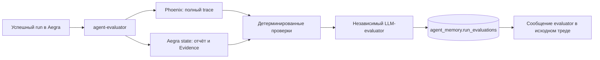

# Фоновая оценка runs через Phoenix

## Назначение

`agent-evaluator` — независимый контур проверки уже завершённых runs. Он не участвует
в расследовании, не изменяет исходный отчёт и не запускает автоматический rework.
Это отделяет фактическую работу агента от последующей оценки её качества.

Evaluator не считает Phoenix доказательством истинности внешних данных. Trace показывает,
как выполнялся run; Evidence по-прежнему нужны для обоснования выводов.

## Поток работы



Worker периодически просматривает последние треды и успешные runs. Если trace ещё не
появился в Phoenix, run остаётся на повторную попытку. Обработанный `run_id` сохраняется
и повторно не оценивается. Отменённые и ещё выполняющиеся runs пропускаются.

## Что проверяется

Детерминированные проверки:

- spans со статусом `ERROR`;
- claims со ссылками на несуществующие Evidence;
- partial/error Evidence;
- ошибки памяти и недоступность критиков;
- число spans, ошибок, Evidence, claims и токенов;
- длительность trace и выбранный режим работы.

LLM дополнительно оценивает:

- соответствие выводов содержимому Evidence;
- категоричность выводов при малом окне или отсутствии baseline;
- соответствие ответа задаче и выбранному Intent;
- отражение ограничений и преждевременное завершение;
- проблемы маршрутизации и ограничения tool calls.

Обычный разговор и read-only обзор памяти не обязаны содержать Evidence.

## Модель результата

Результат содержит:

- `verdict`: `pass`, `warn` или `fail`;
- `score`: оценка качества от 0 до 1;
- краткое summary;
- issues с severity, категорией, рекомендацией и связанными Evidence/span ID;
- метрики run, trace ID и модель evaluator.

Критическая детерминированная проблема всегда даёт `fail`, даже если LLM вернула `pass`.
При недоступности LLM сохраняются детерминированные проверки и явное предупреждение,
а не фиктивный успешный результат.

## Где хранятся результаты

Полные результаты находятся в собственной базе агента:

```text
agent_memory.run_evaluations
```

Ключ — `run_id`. Таблица содержит thread/trace ID, verdict, score, summary, issues,
метрики, полный JSON payload, модель, ошибку публикации и timestamps. Это не Aegra
checkpoint и не Context Memory: оценка не становится фактом окружения.

## Что видит пользователь

После сохранения evaluator добавляет в исходный тред:

- отложенное уведомление **«Автодиагностика»** (AI-сообщение от `evaluator`) с verdict,
  score и до трёх основных замечаний; это не `SystemMessage` и не инструкция для LLM;
- ссылку на trace в Phoenix;
- поле `evaluation` с полным структурированным результатом в state.

Сообщение появляется отдельным checkpoint через Aegra State API. Исходный отчёт и его
артефакты не переписываются. Если пользователь уже запустил более новый run, оценка
сохраняется в БД, но сообщение в активный тред не добавляется. При новом запуске поле
`evaluation` очищается, а прежнее сообщение остаётся в истории.

## Phoenix annotations и golden-сценарии

После оценки evaluator создаёт trace annotation `logicore_agent_quality` через официальный
Phoenix SDK. Она содержит verdict, score, summary и run ID; ошибка annotation не меняет
исходный отчёт и не отменяет сохранение оценки.

`agent-evaluator/scenarios.json` содержит 24 сценария: 18 live и 6 фиксированных.
`agent-evaluator/experiments.py` валидирует их без сети, создаёт Phoenix Dataset и
запускает Experiment только по явному `--execute`. Evaluators проверяют completion,
Scope, Evidence, required tools и повторные запросы. Команды — [OBSERVABILITY.md](OBSERVABILITY.md).

## Настройки

- `EVALUATOR_ENABLED` — включить worker;
- `EVALUATOR_POLL_SECONDS` — период сканирования;
- `EVALUATOR_THREAD_LIMIT` — число последних тредов за проход;
- `EVALUATOR_TRACE_ATTEMPTS` — сколько раз ждать trace;
- `EVALUATOR_TIMEOUT_SECONDS` — timeout LLM-вызова;
- `EVALUATOR_TRACE_ATTRIBUTE_LIMIT` — максимум attributes одного span в контексте evaluator;
- `EVALUATOR_PHOENIX_ANNOTATIONS_ENABLED` — запись оценки как trace annotation;
- `LLM_MODEL_EVALUATOR` — отдельная модель, пусто = `LLM_MODEL`;
- `PHOENIX_PUBLIC_URL` — базовый URL для ссылки пользователя.

Сервис доступен только внутри Docker-сети. Healthcheck: `GET /health`. Для ручной
постановки конкретного run предусмотрен `POST /evaluate/{thread_id}/{run_id}`.

## Ограничения

- Оценка постфактум не доказывает истинность вывода и не заменяет набор golden cases.
- Просмотр последних тредов и последних 1000 spans рассчитан на локальную установку;
  для высокой нагрузки потребуется очередь и пагинация по времени.
- UI показывает сообщение после обновления состояния треда; уже открытому клиенту
  может понадобиться обновление, потому что исходный SSE run завершён.
- Повторная оценка того же run требует удаления его записи из `run_evaluations`.
